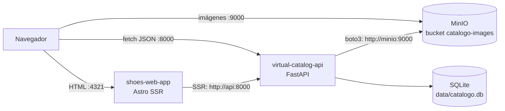

# Catálogo virtual de zapatos

Tienda en línea de zapatos (marca de ejemplo **NovaRun**) desarrollada como proyecto universitario. Permite ver el catálogo, buscar artículos, registrarse, agregar al carrito, generar un pedido y pagarlo.

Este repositorio es un **monorepo** con dos proyectos y la orquestación Docker que los une:

| Carpeta | Qué es | Tecnologías |
| --- | --- | --- |
| [`virtual-catalog-api/`](virtual-catalog-api/) | API REST del negocio | Python 3.12, FastAPI, arquitectura hexagonal, SQLite, MinIO (boto3), pagos Mock/Stripe |
| [`shoes-web-app/`](shoes-web-app/) | Tienda web | Astro 6 (SSR con `@astrojs/node`), React, Zustand, Tailwind |
| [`docker-compose.yml`](docker-compose.yml) | Levanta todo el sistema | MinIO, API y web en contenedores |
| [`docs/`](docs/) | Documentación transversal | Arquitectura del sistema y Docker |



El detalle de este diagrama (URLs internas y públicas, SSR vs. navegador) está en [docs/architecture.md](docs/architecture.md).

## Inicio rápido con Docker

Requisitos: Docker con Docker Compose v2 (`docker compose`). Todos los comandos se ejecutan desde la **raíz del monorepo**.

1. **Configurar la API.** El `.env` es obligatorio: sin él el compose no arranca.

   ```bash
   cp virtual-catalog-api/.env.example virtual-catalog-api/.env
   ```

   Completa los valores. Para usar el compose tal como está:

   ```dotenv
   DATABASE_PATH=data/catalogo.db
   CORS_ORIGINS=["http://localhost:4321"]
   MINIO_ENDPOINT=http://localhost:9000
   MINIO_PUBLIC_URL=http://localhost:9000
   MINIO_ACCESS_KEY=admin
   MINIO_SECRET_KEY=password123
   MINIO_BUCKET=catalogo-images
   PAYMENT_GATEWAY_PROVIDER=mock
   STRIPE_SECRET_KEY=
   ```

   `CORS_ORIGINS`, `MINIO_ENDPOINT` y `MINIO_PUBLIC_URL` se sobrescriben dentro de Docker; los valores de arriba sirven además para ejecutar la API fuera de Docker. Detalle en [docs/docker.md](docs/docker.md#variables-de-entorno).

2. **Construir y levantar** los servicios:

   ```bash
   docker compose up -d --build
   ```

   El orden de arranque es automático: `minio` → `minio-setup` (crea el bucket y termina) → `api` → `web`.

3. **Cargar los datos de prueba** (20 artículos con imágenes):

   ```bash
   docker compose exec api python seed.py
   ```

   No es idempotente: cada ejecución agrega 20 artículos más (ver [seed.md](virtual-catalog-api/docs/seed.md)).

4. **Abrir** la aplicación:

   | Servicio | URL | Notas |
   | --- | --- | --- |
   | Tienda web | http://localhost:4321 | |
   | API | http://localhost:8000/api/v1 | Prefijo de todos los endpoints |
   | Swagger de la API | http://localhost:8000/docs | Probar endpoints desde el navegador |
   | MinIO (API S3) | http://localhost:9000 | De aquí descarga el navegador las imágenes |
   | Consola de MinIO | http://localhost:9001 | Usuario `admin`, contraseña `password123` |

Para detener: `docker compose down` (conserva los datos). `docker compose down -v` borra también la base de datos y las imágenes. Más comandos en [docs/docker.md](docs/docker.md#comandos-habituales).

> Para probar el flujo de compra hay que registrar un usuario desde la web (`/login`); el seed solo crea artículos. Los pagos usan el adaptador **mock** por defecto, que aprueba cualquier token salvo `tok_declined`, `tok_insufficient_funds` y `tok_timeout` (ver [payments.md](virtual-catalog-api/docs/payments.md)).

## Cómo leer la documentación

La documentación está repartida en tres niveles. **El `README.md` de cada proyecto es su índice**: empieza siempre por ahí.

| Ubicación | Contenido |
| --- | --- |
| [`README.md`](README.md) (este archivo) | Qué es el proyecto, inicio rápido y mapa de la documentación |
| [`docs/`](docs/) | Lo que involucra a más de un proyecto: [architecture.md](docs/architecture.md) (sistema completo) y [docker.md](docs/docker.md) (compose, imágenes, volúmenes, problemas comunes) |
| [`virtual-catalog-api/`](virtual-catalog-api/README.md) | Todo lo interno de la API: [`docs/`](virtual-catalog-api/docs/) con arquitectura hexagonal, dominio, endpoints, base de datos, pagos, almacenamiento, seguridad, configuración, seed, tests y limitaciones |
| [`shoes-web-app/`](shoes-web-app/README.md) | Todo lo interno de la web: [`docs/`](shoes-web-app/docs/) con arquitectura, páginas, cliente HTTP, estado, autenticación, estilos, configuración, desarrollo y limitaciones |

### Orden de lectura recomendado

Todos los perfiles empiezan por este README y por [docs/architecture.md](docs/architecture.md).

**Backend (API)**

1. [API: README](virtual-catalog-api/README.md) y [architecture.md](virtual-catalog-api/docs/architecture.md): capas, puertos y adaptadores.
2. [domain.md](virtual-catalog-api/docs/domain.md): agregados, value objects y reglas de negocio.
3. [api-reference.md](virtual-catalog-api/docs/api-reference.md) y [errors-and-validation.md](virtual-catalog-api/docs/errors-and-validation.md).
4. [database.md](virtual-catalog-api/docs/database.md), [payments.md](virtual-catalog-api/docs/payments.md), [storage.md](virtual-catalog-api/docs/storage.md), [security.md](virtual-catalog-api/docs/security.md).
5. [configuration.md](virtual-catalog-api/docs/configuration.md), [development.md](virtual-catalog-api/docs/development.md), [testing.md](virtual-catalog-api/docs/testing.md), [seed.md](virtual-catalog-api/docs/seed.md).
6. [known-issues.md](virtual-catalog-api/docs/known-issues.md) antes de cambiar algo importante.

**Frontend (web)**

1. [Web: README](shoes-web-app/README.md) y [architecture.md](shoes-web-app/docs/architecture.md): módulos, stores y gateways.
2. [pages.md](shoes-web-app/docs/pages.md): rutas y qué se renderiza en el servidor.
3. [api-client.md](shoes-web-app/docs/api-client.md), [state-management.md](shoes-web-app/docs/state-management.md) y [auth.md](shoes-web-app/docs/auth.md): cómo se llama a la API, los stores y la sesión.
4. [configuration.md](shoes-web-app/docs/configuration.md), [development.md](shoes-web-app/docs/development.md) y [styles.md](shoes-web-app/docs/styles.md).
5. [known-issues.md](shoes-web-app/docs/known-issues.md) antes de cambiar algo importante.
6. Del lado de la API, lo que consume la web: [api-reference.md](virtual-catalog-api/docs/api-reference.md) y [known-issues.md](virtual-catalog-api/docs/known-issues.md) (formatos de respuesta, autorización).

**DevOps / integración continua**

1. [docs/docker.md](docs/docker.md): servicios, imágenes, volúmenes, variables y comandos.
2. [API: configuration.md](virtual-catalog-api/docs/configuration.md) y [Web: configuration.md](shoes-web-app/docs/configuration.md): todas las variables de entorno.
3. [API: storage.md](virtual-catalog-api/docs/storage.md): MinIO y URLs interna/pública.
4. [API: testing.md](virtual-catalog-api/docs/testing.md): cómo ejecutar los tests (también dentro del contenedor).
5. [API: known-issues.md](virtual-catalog-api/docs/known-issues.md): credenciales fijas y otros puntos a resolver antes de producción.
