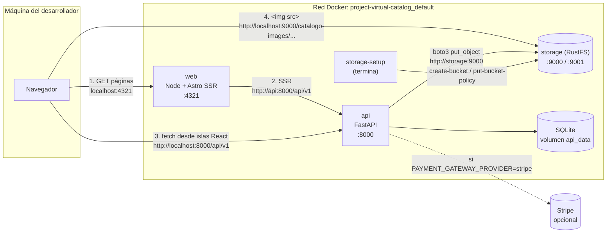
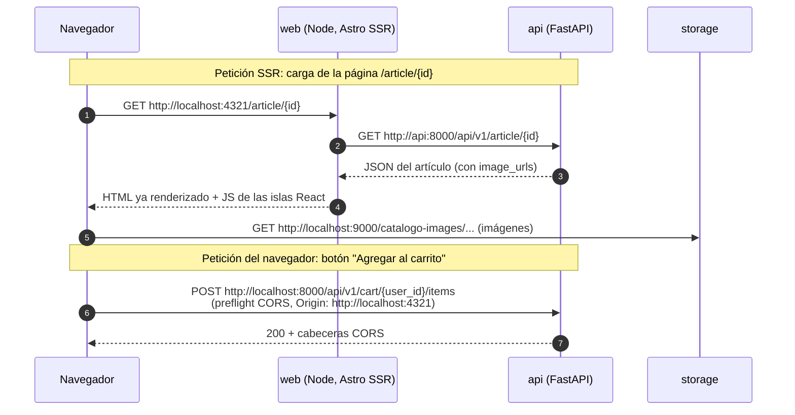
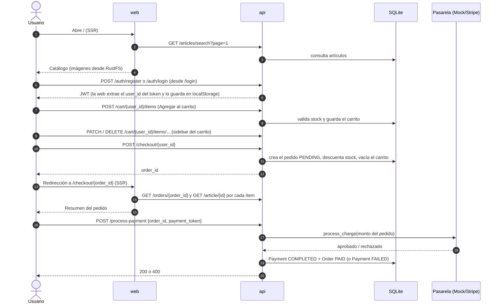

# Arquitectura del sistema

Vista de conjunto: qué componentes hay, cómo se comunican y por qué cada uno usa dos URLs distintas. El diseño interno de cada proyecto está en su propia documentación:

- API: [virtual-catalog-api/docs/architecture.md](../virtual-catalog-api/docs/architecture.md) (hexagonal, puertos y adaptadores).
- Web: [shoes-web-app/docs/architecture.md](../shoes-web-app/docs/architecture.md) (módulos, stores y gateways).

## Componentes

| Componente | Proyecto / imagen | Puerto en el host | Responsabilidad |
| --- | --- | --- | --- |
| **web** | [`shoes-web-app/`](../shoes-web-app/README.md) (Astro 6 + React, `@astrojs/node` standalone) | `4321` | Renderiza el HTML en el servidor (SSR) y entrega las islas React que se hidratan en el navegador |
| **api** | [`virtual-catalog-api/`](../virtual-catalog-api/README.md) (FastAPI + uvicorn) | `8000` | Lógica de negocio: usuarios, catálogo, carrito, pedidos y pagos. Prefijo `/api/v1` |
| **SQLite** | Archivo `data/catalogo.db` dentro de la API | — | Persistencia de todas las entidades ([database.md](../virtual-catalog-api/docs/database.md)) |
| **storage** | `rustfs/rustfs` (RustFS, compatible con S3) | `9000` (S3), `9001` (consola) | Almacena las imágenes de los artículos, bucket `catalogo-images` con lectura pública de objetos ([storage.md](../virtual-catalog-api/docs/storage.md)) |
| **storage-setup** | `amazon/aws-cli` | — | Tarea de arranque: crea el bucket con lectura pública de objetos, luego termina |
| Pasarela de pago | Mock (en proceso) o Stripe (externo) | — | Cobro de pedidos ([payments.md](../virtual-catalog-api/docs/payments.md)) |

SQLite no es un servicio: es un archivo que la API abre directamente. Solo la API lo toca.



Puntos clave:

- **El navegador habla con los tres servicios publicados**: web (HTML), API (datos desde React) y RustFS (imágenes). Las imágenes nunca pasan por la API.
- **Dentro de la red Docker** los servicios se llaman por su nombre (`api`, `storage`). Ese nombre solo existe dentro de la red; el navegador no lo puede resolver.
- La web **no** accede a RustFS ni a SQLite: solo recibe URLs de imágenes ya construidas por la API.

## URLs internas y públicas

Cada vez que un componente llama a otro hay que preguntarse **desde dónde** se hace la llamada. `localhost` dentro de un contenedor es el propio contenedor, no la máquina host.

| Destino | Quién llama | URL en Docker | URL fuera de Docker | Variable |
| --- | --- | --- | --- | --- |
| API | Servidor Astro (SSR) | `http://api:8000/api/v1` | `http://localhost:8000/api/v1` | `INTERNAL_API_URL` (web, runtime) |
| API | Navegador (islas React) | `http://localhost:8000/api/v1` | `http://localhost:8000/api/v1` | `PUBLIC_API_URL` (web, **build**) |
| RustFS | API (subida con boto3) | `http://storage:9000` | `http://localhost:9000` | `S3_ENDPOINT` (api) |
| RustFS | Navegador (descarga de imágenes) | `http://localhost:9000` | `http://localhost:9000` | `S3_PUBLIC_URL` (api) |

### API: `INTERNAL_API_URL` vs. `PUBLIC_API_URL`

`shoes-web-app/src/shared/lib/httpClient.ts` elige la URL base según dónde se ejecuta el código:

```ts
const BASE_URL = import.meta.env.SSR
  ? process.env.INTERNAL_API_URL || import.meta.env.PUBLIC_API_URL || 'http://localhost:8000/api/v1'
  : import.meta.env.PUBLIC_API_URL || 'http://localhost:8000/api/v1';
```

- `import.meta.env.SSR` se resuelve en el build: el bundle del servidor y el del navegador quedan con ramas distintas.
- `INTERNAL_API_URL` se lee de `process.env` **en tiempo de ejecución**, así que basta con definirla en el `environment:` del contenedor.
- `PUBLIC_API_URL` es una variable `PUBLIC_*` de Astro: se **incrusta en el JavaScript durante `npm run build`**. Por eso en Docker se pasa como *build arg* y cambiarla exige reconstruir la imagen (ver [docker.md](docker.md#build-args-vs-variables-de-runtime)).
- Fuera de Docker no hace falta `INTERNAL_API_URL`: el servidor de Astro usa `PUBLIC_API_URL`, porque `localhost:8000` es alcanzable tanto desde el navegador como desde Node.

Detalle de las variables de la web: [shoes-web-app/docs/configuration.md](../shoes-web-app/docs/configuration.md).

### RustFS: `S3_ENDPOINT` vs. `S3_PUBLIC_URL`

La API sube las imágenes con `S3_ENDPOINT` y guarda en la base de datos la URL **completa** construida con `S3_PUBLIC_URL` (`{S3_PUBLIC_URL}/{bucket}/{clave}`). Consecuencia: si cambias `S3_PUBLIC_URL`, las imágenes ya guardadas siguen apuntando a la URL anterior; hay que volver a ejecutar el seed. Detalle en [storage.md](../virtual-catalog-api/docs/storage.md#endpoint-interno-y-url-pública).

### CORS

Solo las peticiones **del navegador** pasan por CORS. Las del SSR son de servidor a servidor y no lo necesitan. `CORS_ORIGINS` debe contener el origen exacto con el que se abre la web (`http://localhost:4321`); `http://127.0.0.1:4321` es un origen distinto.

## Petición SSR vs. petición del navegador

Las páginas `/`, `/article/[id]` y `/checkout/[id]` tienen `prerender = false`: se renderizan en el servidor en cada visita. `/login` no consulta la API en el servidor y se genera como HTML estático en el build. Detalle por página en [shoes-web-app/docs/pages.md](../shoes-web-app/docs/pages.md).



| | Petición SSR | Petición del navegador |
| --- | --- | --- |
| Se ejecuta en | Contenedor `web` (Node) | Navegador del usuario |
| URL base | `INTERNAL_API_URL` | `PUBLIC_API_URL` |
| CORS | No aplica | Sí, `CORS_ORIGINS` |
| Token JWT | No (el store de Zustand vive en `localStorage`, que no existe en el servidor) | Sí, `Authorization: Bearer` si hay sesión |
| Si la API falla | La página muestra un mensaje de error en el HTML (p. ej. "No pudimos conectar con el almacén") | La isla React muestra el error |
| Usos | Catálogo inicial, detalle de artículo, resumen del pedido | Login/registro, búsqueda y paginación, carrito, checkout, pago |

> Hoy la API emite el JWT pero no lo valida en ningún endpoint ([known-issues.md](../virtual-catalog-api/docs/known-issues.md#1-el-jwt-no-se-valida-en-ningún-endpoint)), por eso las peticiones SSR sin token funcionan.

## Flujo de compra end-to-end

Vista de alto nivel. Las reglas de negocio de cada paso están en [domain.md](../virtual-catalog-api/docs/domain.md) y los contratos en [api-reference.md](../virtual-catalog-api/docs/api-reference.md).



Notas:

- Si el usuario no ha iniciado sesión, "Agregar al carrito" lo redirige a `/login`.
- El monto del pago lo calcula la API a partir del pedido, nunca lo envía el cliente.
- La web envía un token de prueba fijo (`test_token_123`), que el adaptador **mock** aprueba. Con `PAYMENT_GATEWAY_PROVIDER=stripe` ese token no es un método de pago válido de Stripe y el pago fallará (ver [payments.md](../virtual-catalog-api/docs/payments.md#adaptador-stripe)).
- Limitaciones que afectan este flujo (checkout no atómico, cobro de un pedido ya pagado): [known-issues.md](../virtual-catalog-api/docs/known-issues.md).

## Persistencia

| Dato | Dónde vive | En Docker |
| --- | --- | --- |
| Usuarios, artículos, carritos, pedidos, pagos | SQLite (`DATABASE_PATH`, p. ej. `data/catalogo.db`) | Volumen `api_data` en `/app/data` |
| Imágenes de artículos | Bucket `catalogo-images` de RustFS | Volumen `storage_data` en `/data` |
| Sesión del usuario (token, `user_id`) | `localStorage` del navegador (`auth-storage`) | — |

Gestión de volúmenes y cómo reiniciar los datos: [docker.md](docker.md#volúmenes).
