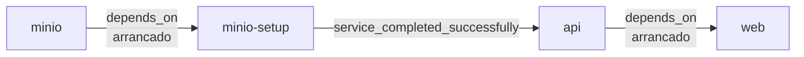

# Docker

Todo el sistema se levanta con el [`docker-compose.yml`](../docker-compose.yml) de la raíz del monorepo. Los comandos de este documento se ejecutan **desde la raíz**.

Para entender por qué hay URLs internas y públicas, lee primero [architecture.md](architecture.md#urls-internas-y-públicas).

## Servicios

```yaml
name: project-virtual-catalog
```

El nombre de proyecto es fijo y coincide con el del compose antiguo (que vivía en `virtual-catalog-api/`), para que Docker reutilice sus contenedores y, sobre todo, su volumen `minio_data` con las imágenes ya subidas. Todos los recursos llevan el prefijo `project-virtual-catalog_`.

| Servicio | Imagen / build | `container_name` | Puertos (host:contenedor) | Ciclo de vida |
| --- | --- | --- | --- | --- |
| `minio` | `minio/minio:latest` | `catalogo_minio` | `9000:9000` (API S3), `9001:9001` (consola) | Permanente |
| `minio-setup` | `minio/mc:latest` | `catalogo_minio_setup` | — | Se ejecuta y termina (`Exited (0)`) |
| `api` | build `./virtual-catalog-api` | `catalogo_api` | `8000:8000` | Permanente |
| `web` | build `./shoes-web-app` | `catalogo_web` | `4321:4321` | Permanente |

### `minio`

Servidor de objetos compatible con S3. Credenciales de administrador en el propio compose: `MINIO_ROOT_USER=admin`, `MINIO_ROOT_PASSWORD=password123`. Ejecuta `server /data --console-address ":9001"`.

### `minio-setup`

Cliente `mc` que prepara MinIO y termina:

```sh
sleep 5
mc alias set local http://minio:9000 admin password123
mc mb local/catalogo-images || true      # crea el bucket (no falla si ya existe)
mc anonymous set public local/catalogo-images   # lectura pública para el navegador
exit 0
```

Termina siempre con código `0`, incluso si algún paso falló (ver [problemas comunes](#problemas-comunes)).

### `api`

Imagen de la API ([`virtual-catalog-api/Dockerfile`](../virtual-catalog-api/Dockerfile)). Lee su configuración de `virtual-catalog-api/.env` (`env_file`) y sobrescribe tres variables (ver [variables de entorno](#variables-de-entorno)). La base de datos SQLite queda en el volumen `api_data`.

### `web`

Imagen de la tienda ([`shoes-web-app/Dockerfile`](../shoes-web-app/Dockerfile)). Recibe `PUBLIC_API_URL` como *build arg* y `INTERNAL_API_URL` como variable de runtime.

## Imágenes

### API: `virtual-catalog-api/Dockerfile`

| Aspecto | Valor |
| --- | --- |
| Base | `python:3.12-slim` |
| Dependencias | `pip install -r requirements.txt` en una capa propia (se cachea mientras `requirements.txt` no cambie) |
| Código | `COPY . .`, incluidos `static/` (imágenes del seed), `seed.py` y `tests/` |
| Comando | `uvicorn app.infrastructure.api.main:app --host 0.0.0.0 --port 8000` (sin `--reload`) |
| `.dockerignore` | Excluye `.env`, `data/`, bases `*.db`, `.venv/`, cachés de Python/pytest y cobertura |

Como `.env` no entra en la imagen, la configuración llega **solo** como variables de entorno del contenedor.

### Web: `shoes-web-app/Dockerfile`

Build multi-etapa sobre `node:22-alpine`:

| Etapa | Qué hace |
| --- | --- |
| `build` | Recibe `ARG PUBLIC_API_URL`, la expone como `ENV`, ejecuta `npm ci` y `npm run build` → `dist/` |
| `runtime` | `npm ci --omit=dev`, copia `dist/` de la etapa anterior y ejecuta `node ./dist/server/entry.mjs` con `HOST=0.0.0.0`, `PORT=4321`, `NODE_ENV=production` |

`.dockerignore` excluye `node_modules`, `dist`, `.astro`, `.env` y `.env.production`, así que **el `shoes-web-app/.env` local no influye en la imagen**: el valor de `PUBLIC_API_URL` sale únicamente del build arg del compose.

## Orden de arranque



- `api` espera a que `minio-setup` **termine con éxito**, es decir, a que exista el bucket.
- `minio-setup` y `web` solo esperan a que su dependencia **arranque**, no a que esté lista (no hay `healthcheck`). Por eso `minio-setup` hace `sleep 5` antes de conectarse.
- Si la API tarda en arrancar, las primeras peticiones SSR de la web pueden fallar; basta con recargar.

## Redes

No se declaran redes: Compose crea la red por defecto `project-virtual-catalog_default` y conecta los cuatro servicios. Dentro de ella cada servicio se resuelve por su nombre (`minio`, `api`, `web`). Desde el host solo se llega a los puertos publicados en `localhost`.

## Volúmenes

| Volumen (nombre real) | Montado en | Contiene |
| --- | --- | --- |
| `project-virtual-catalog_minio_data` | `minio:/data` | Buckets e imágenes |
| `project-virtual-catalog_api_data` | `api:/app/data` | Base de datos SQLite (`catalogo.db`) |

`DATABASE_PATH=data/catalogo.db` es relativo a la carpeta de la API, así que se resuelve a `virtual-catalog-api/data/catalogo.db` en local y a `/app/data/catalogo.db` en el contenedor, justo donde se monta `api_data` (ver [configuration.md](../virtual-catalog-api/docs/configuration.md#valores-en-docker)). La base de datos local y la del contenedor son **archivos distintos**.

```bash
docker volume ls | grep project-virtual-catalog
```

## Variables de entorno

### API

`env_file: ./virtual-catalog-api/.env` aporta todas las variables que exige `Settings` ([configuration.md](../virtual-catalog-api/docs/configuration.md)). El bloque `environment:` tiene prioridad y sobrescribe las que dependen de la red:

| Variable | Valor en el compose | Por qué |
| --- | --- | --- |
| `MINIO_ENDPOINT` | `http://minio:9000` | Dentro del contenedor `localhost` es la propia API; a MinIO se llega por su nombre de servicio |
| `MINIO_PUBLIC_URL` | `http://localhost:9000` | Es la URL que se guarda en la base de datos y usa el navegador, que solo conoce el puerto publicado |
| `CORS_ORIGINS` | `["http://localhost:4321"]` | Origen de la web publicada por el compose |

Lo que **no** se sobrescribe y debe ser coherente con el compose:

| Variable | Debe valer | Coincide con |
| --- | --- | --- |
| `MINIO_ACCESS_KEY` | `admin` | `MINIO_ROOT_USER` de `minio` |
| `MINIO_SECRET_KEY` | `password123` | `MINIO_ROOT_PASSWORD` de `minio` |
| `MINIO_BUCKET` | `catalogo-images` | Bucket creado por `minio-setup` |
| `DATABASE_PATH` | `data/catalogo.db` (relativa) | Punto de montaje de `api_data` |
| `PAYMENT_GATEWAY_PROVIDER` | `mock` o `stripe` | — |

### Web

| Variable | Tipo | Valor | Usada por |
| --- | --- | --- | --- |
| `PUBLIC_API_URL` | **build arg** | `http://localhost:8000/api/v1` | Código del navegador (islas React) |
| `INTERNAL_API_URL` | **runtime** (`environment:`) | `http://api:8000/api/v1` | Servidor Astro (SSR) |

Detalle en [shoes-web-app/docs/configuration.md](../shoes-web-app/docs/configuration.md).

### Build args vs. variables de runtime

| | Build arg (`build.args`) | Runtime (`environment:` / `env_file:`) |
| --- | --- | --- |
| Cuándo se lee | Durante `docker compose build` | Al arrancar el contenedor |
| Dónde queda | Incrustado en el bundle JS (Astro reemplaza `import.meta.env.PUBLIC_*`) | Solo en el entorno del proceso |
| Para cambiarlo | `docker compose up -d --build web` | `docker compose up -d web` (recrea el contenedor) |
| Ejemplos | `PUBLIC_API_URL` | `INTERNAL_API_URL`, todas las de la API |

Si cambias el `.env` de la API, basta con `docker compose up -d api`: Compose detecta el cambio y recrea el contenedor. No hace falta reconstruir.

## Comandos habituales

| Tarea | Comando |
| --- | --- |
| Construir y levantar todo | `docker compose up -d --build` |
| Levantar sin reconstruir | `docker compose up -d` |
| Reconstruir un servicio | `docker compose build api` / `docker compose up -d --build web` |
| Estado de los servicios | `docker compose ps -a` (`-a` muestra también `minio-setup` terminado) |
| Logs (seguir) | `docker compose logs -f api` / `docker compose logs -f web` |
| Logs de la preparación de MinIO | `docker compose logs minio-setup` |
| Cargar datos de prueba | `docker compose exec api python seed.py` |
| Tests de la API en el contenedor | `docker compose exec api pytest -v` |
| Shell en un contenedor | `docker compose exec api sh` / `docker compose exec web sh` |
| Reiniciar un servicio | `docker compose restart api` |
| Detener sin borrar contenedores | `docker compose stop` |
| Detener y borrar contenedores y red | `docker compose down` |
| **Borrar también los datos** | `docker compose down -v` |

`docker compose down` elimina contenedores y la red, pero **conserva** los volúmenes: al volver a levantar, la base de datos y las imágenes siguen ahí.

`docker compose down -v` borra además `minio_data` y `api_data`: **se pierden todos los usuarios, artículos, pedidos e imágenes**. Al volver a levantar, `minio-setup` recrea el bucket vacío y hay que ejecutar de nuevo el seed. Es la forma de empezar de cero (el seed no es idempotente, ver [seed.md](../virtual-catalog-api/docs/seed.md)).

El seed necesita internet desde el contenedor: además de las imágenes de `static/`, descarga una imagen de `https://picsum.photos` por artículo.

## Desarrollo híbrido

Para iterar rápido (recarga en caliente), se puede dejar en Docker solo lo que no cambia.

### Solo MinIO en Docker, API y web locales

```bash
docker compose up -d minio minio-setup
```

Luego, en dos terminales:

```bash
# API (desde virtual-catalog-api/, con su .venv activo)
uvicorn app.infrastructure.api.main:app --reload

# Web (desde shoes-web-app/)
npm run dev
```

- La API usa los valores del `.env` tal cual (`MINIO_ENDPOINT=http://localhost:9000`), porque corre en el host. Guía completa: [API: development.md](../virtual-catalog-api/docs/development.md).
- La web solo necesita `PUBLIC_API_URL=http://localhost:8000/api/v1`; sin `INTERNAL_API_URL`, el SSR usa esa misma URL. Guía completa: [Web: development.md](../shoes-web-app/docs/development.md).
- La API local usa `virtual-catalog-api/data/catalogo.db`, no la base del volumen: ejecuta `python seed.py` localmente.

### API en Docker, web local

```bash
docker compose up -d api      # arranca también minio y minio-setup
cd shoes-web-app && npm run dev
```

Funciona porque el puerto `8000` está publicado y `CORS_ORIGINS` permite `http://localhost:4321`.

> No dejes corriendo el contenedor que vas a reemplazar: `docker compose stop api` (o `web`) antes de arrancar su versión local, o habrá conflicto de puertos.

## Problemas comunes

| Síntoma | Causa y solución |
| --- | --- |
| `env file .../virtual-catalog-api/.env not found` | Falta el `.env` de la API. `cp virtual-catalog-api/.env.example virtual-catalog-api/.env` y complétalo. |
| `api` aparece como `Exited (1)` con `ValidationError ... Field required` en los logs | Falta una variable en el `.env` o quedó vacía. `docker compose logs api` indica cuál; corrige y ejecuta `docker compose up -d api`. |
| `Conflict. The container name "/catalogo_minio" is already in use` | Existe un contenedor con ese nombre fijo que pertenece a otro proyecto de Compose (por ejemplo, el compose antiguo levantado con otro nombre de proyecto). Revisa con `docker ps -a --filter name=catalogo_` y elimínalo con `docker rm -f catalogo_minio`; los datos están en el volumen, no en el contenedor. |
| `Bind for 0.0.0.0:8000 failed: port is already allocated` (o 4321, 9000, 9001) | Otro proceso usa el puerto, a menudo la API o la web ejecutándose en local. Detén ese proceso o cambia el puerto del host en el compose (`"8001:8000"`, y entonces actualiza también `PUBLIC_API_URL` y reconstruye la web). |
| `npm run dev` arranca en `4322` en lugar de `4321` | El contenedor `web` ocupa el 4321. Detenlo (`docker compose stop web`); si no, el origen `localhost:4322` no está en `CORS_ORIGINS`. |
| Las imágenes no cargan en el navegador | `MINIO_PUBLIC_URL` no es accesible desde el navegador o las URLs guardadas son de otra configuración (por ejemplo, se sembró con `http://minio:9000`). Revisa una URL en `GET /api/v1/articles` y, si está mal, ejecuta `docker compose down -v`, levanta y vuelve a sembrar. |
| Imágenes con `403 AccessDenied` | El bucket no es público: `minio-setup` falló (p. ej. MinIO tardó más de 5 s). Revisa `docker compose logs minio-setup` y ejecútalo de nuevo con `docker compose up minio-setup`. |
| `500 Error al subir la imagen a MinIO` al sembrar o crear artículos | El bucket no existe o `MINIO_ACCESS_KEY`/`MINIO_SECRET_KEY`/`MINIO_BUCKET` del `.env` no coinciden con el compose. |
| La web muestra "No pudimos conectar con el almacén" | El SSR no alcanza la API: el contenedor `api` no está arriba o `INTERNAL_API_URL` es incorrecta. Revisa `docker compose ps` y `docker compose logs api`. |
| Error de CORS en la consola del navegador | Abriste la web con un origen distinto de `http://localhost:4321` (p. ej. `127.0.0.1`). Usa `localhost` o agrega el origen a `CORS_ORIGINS` en el compose. |
| Cambié `PUBLIC_API_URL` y la web sigue usando la anterior | Es un build arg: `docker compose up -d --build web`. |
| Los datos del contenedor no aparecen al ejecutar la API local (o al revés) | Son bases distintas: el volumen `api_data` frente a `virtual-catalog-api/data/catalogo.db`. |
