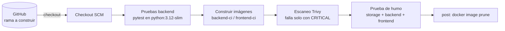
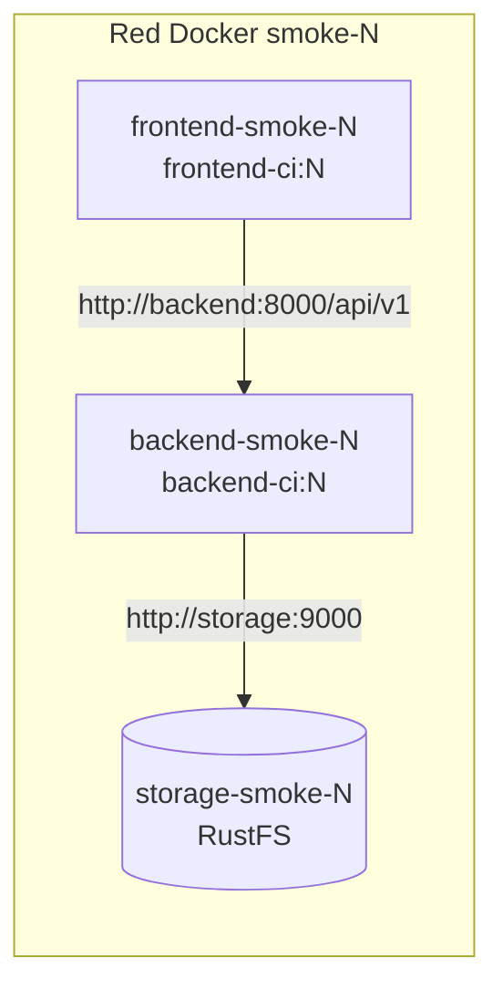

# Integración continua con Jenkins

El pipeline está definido como código en el [`Jenkinsfile`](../Jenkinsfile) de la raíz del monorepo. En cada ejecución prueba la API, construye las dos imágenes, las escanea con Trivy y comprueba que el sistema arranca y que sus piezas se conectan (prueba de humo).

Este documento explica cómo levantar el Jenkins del repositorio, cómo crear la tarea (*job*) que ejecuta el pipeline y qué hace cada etapa. Los comandos se ejecutan **desde la raíz del monorepo**.



Si una etapa falla, las siguientes no se ejecutan; el bloque `post` final se ejecuta siempre.

## Levantar Jenkins

Jenkins es un servicio más del [`docker-compose.yml`](../docker-compose.yml) (`jenkins`, contenedor `jenkins-ci`). Su imagen se construye desde [`jenkins/`](../jenkins/):

| Archivo | Qué aporta |
| --- | --- |
| [`jenkins/Dockerfile`](../jenkins/Dockerfile) | Parte de `jenkins/jenkins:lts-jdk21`, agrega la CLI de Docker y el plugin de Compose (copiados de `docker:cli`), instala los plugins y desactiva el asistente de instalación |
| [`jenkins/plugins.txt`](../jenkins/plugins.txt) | Plugins instalados al construir la imagen (ver [Plugins](#plugins)) |
| [`jenkins/jenkins.yaml`](../jenkins/jenkins.yaml) | Configuración como código (JCasC): usuario administrador, 2 ejecutores, sin registro público ni lectura anónima, URL pública |

1. **Definir la contraseña del administrador** en el `.env` de la raíz (es obligatoria; sin ella el compose no arranca):

   ```dotenv
   JENKINS_ADMIN_PASSWORD=<openssl rand -hex 20>
   JENKINS_ADMIN_USER=admin   # opcional, admin por defecto
   JENKINS_PORT=8081          # opcional, 8081 por defecto
   ```

2. **Construir y levantar** solo Jenkins:

   ```bash
   docker compose up -d --build jenkins
   ```

3. **Entrar** en http://localhost:8081 con `JENKINS_ADMIN_USER` / `JENKINS_ADMIN_PASSWORD`. No aparece el asistente de instalación: los plugins y el usuario ya vienen configurados.

La configuración y el historial de builds viven en el volumen `jenkins_home`, así que sobreviven a `docker compose down`. `docker compose down -v` los borra (junto con la base de datos y las imágenes del catálogo).

### Por qué Jenkins corre como root y con el socket de Docker

El pipeline ejecuta `docker build` y `docker run`. Jenkins no tiene un Docker propio: usa el daemon del host montando `/var/run/docker.sock` (*Docker fuera de Docker*). Por eso los contenedores que lanza el pipeline (Python, Trivy, la prueba de humo) son **hermanos** del contenedor de Jenkins en el host, no hijos.

- `user: root` evita depender del GID del grupo `docker` del host, que cambia entre sistemas.
- `security_opt: label=disable` hace falta en Fedora/RHEL, donde SELinux bloquea el uso del socket montado; en otros sistemas se ignora.

Las dos decisiones dan a Jenkins control total sobre el Docker del host: **solo son aceptables en un laboratorio local**.

### Plugins

| Plugin | Para qué lo usa el pipeline |
| --- | --- |
| `workflow-aggregator` | Pipelines declarativos (`pipeline { ... }`) |
| `git` | Descargar el repositorio (*Pipeline script from SCM*) |
| `docker-workflow` | `agent { docker { ... } }` de la etapa de pruebas |
| `junit` | Publicar los resultados de pytest en la vista del build |
| `configuration-as-code` | Leer `jenkins.yaml` al arrancar |
| `pipeline-graph-view` | Vista gráfica de las etapas |
| `timestamper` | Instalado, pero el `Jenkinsfile` **no** usa `timestamps()` a propósito: así el pipeline funciona también en un Jenkins que no tenga este plugin |

Si se usa otro Jenkins, necesita al menos `workflow-aggregator`, `git`, `docker-workflow` y `junit`, más la CLI de Docker con acceso a un daemon.

## Configurar la tarea (job)

La tarea solo le dice a Jenkins **de dónde** sacar el código y **cuándo** ejecutarlo; los pasos están en el `Jenkinsfile`. Los nombres de los menús dependen del idioma de Jenkins: se indican en inglés con la traducción al español entre paréntesis.

1. En el panel principal, **New Item** (*Nueva Tarea*).
2. Escribe un nombre (por ejemplo `virtual-shoes-catalog`), elige **Pipeline** y pulsa **OK**.
3. En **General**, opcional: **Discard old builds** (*Desechar ejecuciones antiguas*) con un máximo de builds a conservar (por ejemplo 10), para que el historial no crezca sin límite.
4. En **Build Triggers** (*Disparadores de ejecuciones*), elige cuándo se ejecuta (ver [Disparadores](#disparadores)). Para que se ejecute tras cada push: **Poll SCM** con `H/2 * * * *`.
5. En la sección **Pipeline**:

   | Campo | Valor |
   | --- | --- |
   | Definition | `Pipeline script from SCM` |
   | SCM | `Git` |
   | Repository URL | `https://github.com/soyeison/virtual-shoes-catalog` |
   | Credentials | `- none -` (el repositorio es público) |
   | Branch Specifier | `*/main` |
   | Script Path | `Jenkinsfile` |
   | Lightweight checkout | Marcado (lee el `Jenkinsfile` sin clonar todo el repositorio; el clon completo lo hace después la etapa *Checkout SCM*) |

6. **Save** (*Guardar*) y, para la primera ejecución, **Build Now** (*Construir ahora*).

Si el repositorio fuera privado, en **Credentials** se agrega una credencial *Username with password* con el usuario de GitHub y un *personal access token* como contraseña.

### Disparadores

| Opción | Cuándo ejecuta | Uso recomendado |
| --- | --- | --- |
| **Poll SCM** (*Consultar repositorio (SCM)*) | Consulta el repositorio según el cron y **solo construye si hay commits nuevos** en la rama | La mejor opción para un Jenkins local: tras un `git push`, el build empieza en menos de 2 minutos |
| **Build periodically** (*Ejecutar periódicamente*) | Según el cron, **haya o no cambios** | Builds nocturnos. Con `H/2 * * * *` lanza un build cada 2 minutos aunque nadie haya hecho push |
| **GitHub hook trigger** | Cuando GitHub envía un webhook | Requiere el plugin `github` (no instalado) y que GitHub alcance a Jenkins; con `localhost` no llega sin un túnel (ngrok o similar) |
| Ninguno | Solo con **Build Now** | Pruebas manuales |

En la expresión cron `H/2 * * * *`, `H` reparte la carga: Jenkins elige un minuto fijo por tarea en lugar de lanzar todas a la vez en el minuto 0. Los campos son minuto, hora, día del mes, mes y día de la semana.

### Flujo de trabajo

La tarea construye la rama `main`. Cada vez que llega un commit nuevo a `main` (un `git push origin main` o un pull request integrado), el disparador lo detecta y Jenkins ejecuta el pipeline completo sobre ese commit.

## Cómo se ejecuta el pipeline

El pipeline declara `agent any`: todas las etapas corren en el ejecutor de Jenkins, sobre el *workspace* donde se descargó el repositorio. Las imágenes y redes llevan `${BUILD_NUMBER}` en el nombre para que dos builds no se pisen.

| Etapa | Qué hace | Falla si |
| --- | --- | --- |
| *Checkout SCM* | Implícita: clona la rama configurada en la tarea | No se puede acceder al repositorio |
| Pruebas backend | Ejecuta pytest con cobertura dentro de `python:3.12-slim` | Falla algún test |
| Construir imágenes | `docker build` de `backend-ci:N` y `frontend-ci:N` | No compila alguna imagen |
| Escaneo de seguridad (Trivy) | Reporta vulnerabilidades HIGH y CRITICAL de las dos imágenes | Alguna imagen tiene una vulnerabilidad CRITICAL |
| Prueba de humo | Levanta almacenamiento, backend y frontend en una red aislada y comprueba que responden | El backend no queda listo o el frontend no obtiene el catálogo |

### Pruebas backend

Equivale al job `api-tests` de [`.github/workflows/ci.yml`](../.github/workflows/ci.yml).

- `agent { docker { image 'python:3.12-slim'; reuseNode true } }`: los pasos corren dentro de un contenedor de Python que comparte el *workspace* de Jenkins (`reuseNode`). Los dos parámetros van en líneas separadas; en una sola, Groovy los interpreta como una llamada encadenada y falla.
- Crea un entorno virtual limpio (`python -m venv --clear .venv`) en cada build e instala `requirements.txt`.
- `PIP_CACHE_DIR` apunta a `${WORKSPACE}/.pip-cache`: la caché de pip se conserva entre builds, como `cache: pip` en GitHub Actions. Está fuera de `virtual-catalog-api/`, así que no entra en el contexto de la imagen.
- Ejecuta `pytest -v --cov=app --cov-report=term-missing --junitxml=test-results/junit.xml`. La cobertura aparece en el log; el XML lo publica `junit` en el bloque `post` (aunque los tests fallen), y Jenkins muestra los resultados en **Test Result** del build.

Cómo ejecutar los mismos tests en local: [API: testing.md](../virtual-catalog-api/docs/testing.md).

### Construir imágenes

```sh
docker build -t backend-ci:${BUILD_NUMBER} ./virtual-catalog-api
docker build -t frontend-ci:${BUILD_NUMBER} ./shoes-web-app
```

Los Dockerfiles son los mismos que usa el compose ([docs/docker.md](docker.md#imágenes)). La web se construye sin `PUBLIC_API_URL`: la prueba de humo solo usa el SSR, que lee `INTERNAL_API_URL` en runtime.

### Escaneo de seguridad (Trivy)

Trivy corre como contenedor y lee las imágenes a través del socket de Docker. Por cada imagen hace dos pasadas:

1. Un **reporte** con HIGH y CRITICAL (`--exit-code 0`): se muestra en el log y nunca falla.
2. Una **comprobación** solo de CRITICAL (`--exit-code 1`, salida descartada): si encuentra alguna, anota la imagen.

Las dos imágenes se escanean siempre, y al final la etapa falla si alguna tuvo CRITICAL, indicando cuál. Así un build fallido muestra todos los problemas de una vez.

- La imagen de Trivy está **fijada por digest** (`aquasec/trivy:0.76.2@sha256:...`): en marzo de 2026 se publicaron imágenes maliciosas de Trivy en Docker Hub, incluida `latest`. Una etiqueta se puede reapuntar a otra imagen; un digest no.
- El volumen `trivy-cache` guarda la base de datos de vulnerabilidades entre builds: solo la primera ejecución la descarga completa, y la segunda pasada de cada build es rápida.
- Para corregir una CRITICAL normalmente basta con actualizar la dependencia afectada (ejemplos en el historial: `fix: upgrade PyJWT ...`, `fix: upgrade Astro ...`).

### Prueba de humo

Comprueba que el build **arranca** y que sus piezas **se conectan**, sin el compose y sin depender de ningún `.env`:



1. Crea la red `smoke-N` y un `trap` que borra los contenedores y la red al terminar, pase lo que pase.
2. Genera **credenciales desechables** con `/dev/urandom` (S3 y `JWT_SECRET_KEY`). Se pasan a Docker solo por nombre (`-e VAR`), y con `set +x`, para que sus valores no aparezcan en el log.
3. Arranca RustFS y crea el bucket con `aws-cli` (hasta 20 intentos cada 3 s), porque el *readiness* del backend exige que el bucket exista.
4. Arranca el backend (pagos `mock`, SQLite dentro del contenedor) y el frontend. La configuración que no es secreta (`S3_BUCKET`, `S3_REGION`, `JWT_ALGORITHM`, `JWT_EXPIRATION_MINUTES`) está en el bloque `environment` de la etapa.
5. Comprueba, desde dentro del contenedor del frontend:
   - **Backend listo**: `GET /api/v1/health/ready` responde 200, lo que significa que la base de datos y el almacenamiento funcionan (hasta 20 intentos).
   - **Frontend funcionando**: la portada se renderiza y **no** contiene "No pudimos conectar". Hace falta buscar ese texto porque, si el SSR no alcanza la API, la página igual responde 200. Se usa `127.0.0.1` y no `localhost`: en Alpine `localhost` resuelve a `::1` y Astro solo escucha en IPv4.
6. Si algo falla, imprime los logs de los tres contenedores antes de terminar.

Los endpoints de salud se describen en [API: api-reference.md](../virtual-catalog-api/docs/api-reference.md).

### Bloque `post`

`docker image prune -f` se ejecuta siempre al final y borra las imágenes **sin etiqueta** (*dangling*) que dejan los builds. No borra `backend-ci:N` ni `frontend-ci:N` (ver [Limitaciones](#limitaciones)).

## Ver los resultados

| Dónde | Qué muestra |
| --- | --- |
| Página de la tarea | Historial de builds y su estado; con `pipeline-graph-view`, el grafo de etapas de cada build |
| Build → **Console Output** | Log completo: salida de pytest con cobertura, reportes de Trivy, mensajes de la prueba de humo |
| Build → **Test Result** | Tests de pytest publicados por `junit`, con los que fallaron y su traza |

Los mensajes finales de cada etapa están pensados para buscarse en el log: `Escaneo fallido: vulnerabilidades CRITICAL en: ...`, `Prueba de humo fallida: ...`, `Prueba de humo superada`.

## Jenkins y GitHub Actions

El repositorio tiene los dos sistemas. El pipeline de Jenkins cubre lo mismo que el workflow de Actions y agrega etapas:

| | GitHub Actions ([`ci.yml`](../.github/workflows/ci.yml)) | Jenkins ([`Jenkinsfile`](../Jenkinsfile)) |
| --- | --- | --- |
| Cuándo | Push a `main` y pull requests | Según el disparador de la tarea, en la rama configurada |
| Tests de la API | `api-tests` | Pruebas backend (además publica el reporte JUnit) |
| Imágenes | `build-images` (matriz, sin push) | Construir imágenes |
| Escaneo de vulnerabilidades | — | Trivy |
| Prueba de humo | — | Levanta los contenedores y los prueba |
| Dónde corre | Runners de GitHub | Jenkins local, con el Docker del host |

## Problemas comunes

| Síntoma | Causa y solución |
| --- | --- |
| `required variable JENKINS_ADMIN_PASSWORD is missing a value` | Falta en el `.env` de la raíz. Agrégala y ejecuta `docker compose up -d jenkins`. |
| `docker: not found` en el log | El Jenkins que ejecuta la tarea no tiene la CLI de Docker. Usa la imagen de [`jenkins/`](../jenkins/) o instálala en ese Jenkins. |
| `permission denied while trying to connect to the Docker daemon socket` | Jenkins no puede usar el socket. En el compose se resuelve con `user: root`; en Fedora/RHEL también hace falta `label=disable` (SELinux). |
| `Invalid agent type "docker" specified` | Falta el plugin `docker-workflow`. |
| `No such DSL method 'timestamps'` | Un `Jenkinsfile` modificado usa `timestamps()` y ese Jenkins no tiene el plugin `timestamper`. Quita la opción. |
| `detected dubious ownership in repository` | El repositorio pertenece a otro usuario. La imagen de [`jenkins/`](../jenkins/) ya ejecuta `git config --system --add safe.directory '*'`. |
| Se ejecuta un build cada 2 minutos sin haber hecho push | El disparador es **Build periodically**. Cámbialo por **Poll SCM** con el mismo cron. |
| Hice push y no se ejecuta nada | El disparador no está configurado, o el **Branch Specifier** no coincide con la rama del push (debe ser `*/main`). |
| `Escaneo fallido: vulnerabilidades CRITICAL en: ...` | Busca en el reporte de esa imagen (más arriba en el log) el paquete y la versión corregida, y actualiza la dependencia. |
| `Prueba de humo fallida: el backend no quedó listo` | Revisa los logs de `backend` que imprime la etapa: suele ser una variable de entorno nueva que la etapa no pasa, o el almacenamiento sin bucket. |
| `Prueba de humo fallida: el frontend no pudo obtener el catálogo del backend` | El SSR no alcanza `http://backend:8000/api/v1` o la API responde con error al listar artículos. Revisa los logs de `backend` y `frontend`. |
