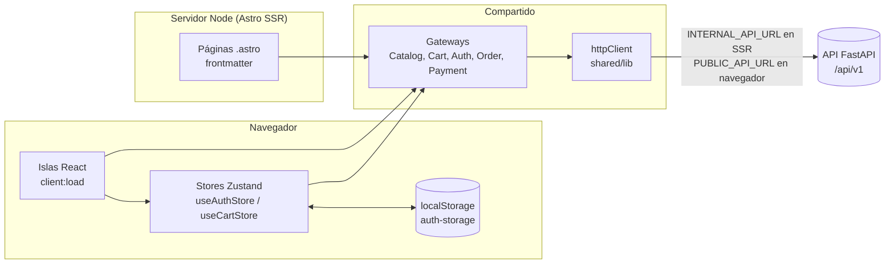
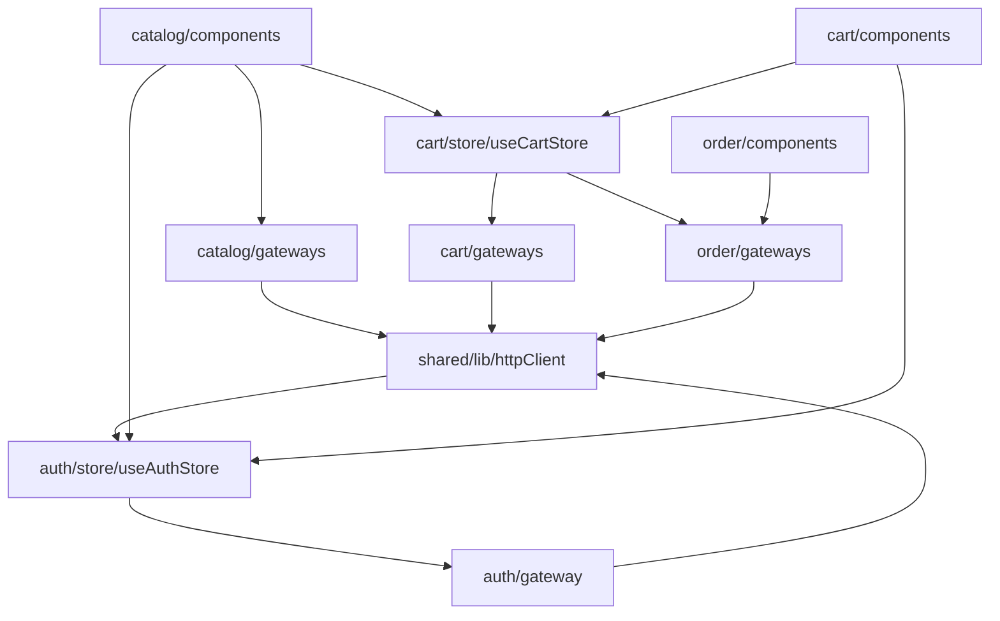
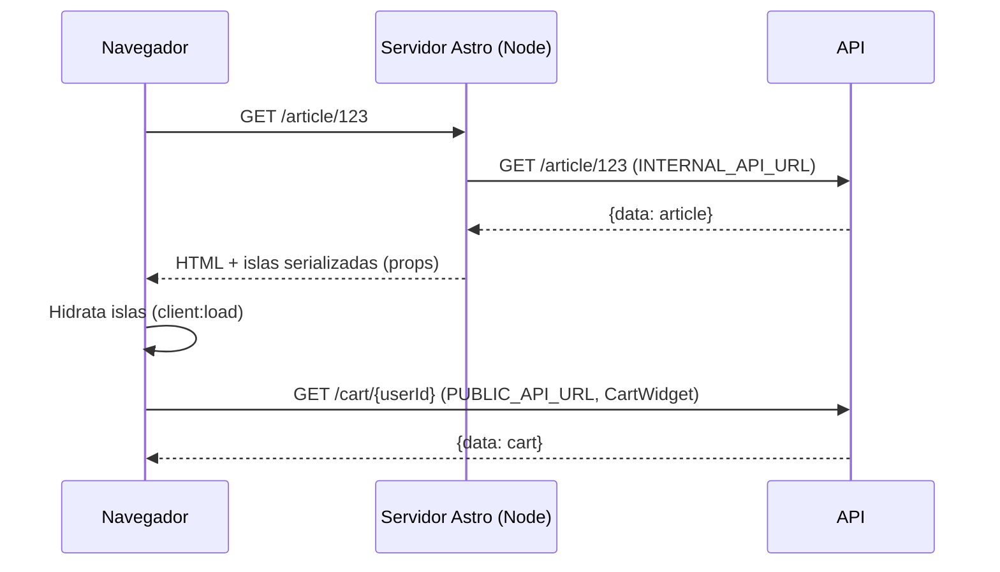

# Arquitectura

El frontend es una aplicación **Astro 6** con renderizado en servidor (SSR) mediante el adapter `@astrojs/node`, e **islas de React 19** para las partes interactivas. El estado del cliente vive en **stores de Zustand** y todo el acceso a la API pasa por un único cliente HTTP (`httpClient`) envuelto en **gateways** por módulo.



El mismo código de gateways se ejecuta en los dos entornos: en el frontmatter de las páginas (servidor) y dentro de las islas o stores (navegador). Lo único que cambia es la URL base que resuelve `httpClient` (ver [configuration.md](configuration.md)).

## Estructura de carpetas

```
src/
├── pages/                     # Rutas (enrutamiento por archivos de Astro)
│   ├── index.astro            # /                 SSR: catálogo
│   ├── login.astro            # /login            estática (prerender)
│   ├── article/[id].astro     # /article/:id      SSR: detalle
│   └── checkout/[id].astro    # /checkout/:id     SSR: resumen de orden y pago
├── modules/                   # Código por dominio funcional
│   ├── catalog/
│   │   ├── components/        # CatalogSearchGrid, ArticleCard, ImageGallery
│   │   ├── gateways/          # CatalogGateway
│   │   └── models/            # Article, SearchArticleItem, PaginationMeta, SearchResult
│   ├── cart/
│   │   ├── components/        # CartWidget, CartSidebar, AddToCartButton
│   │   ├── gateways/          # CartGateway
│   │   ├── models/            # Cart, CartItem, requests
│   │   └── store/             # useCartStore
│   ├── auth/
│   │   ├── components/        # LoginForm, AuthWidget
│   │   ├── gateway/           # AuthGateway   (ojo: "gateway" en singular)
│   │   ├── models/            # UserLoginRequest, UserRegisterRequest, AuthResponse
│   │   └── store/             # useAuthStore (con persistencia)
│   └── order/
│       ├── components/        # PaymentProcessor
│       └── gateways/          # OrderGateway, PaymentGateway (los tipos viven aquí, no hay models/)
├── shared/
│   ├── lib/httpClient.ts      # Cliente HTTP único + tipo ApiResponse<T>
│   ├── layouts/MainLayout.astro  # Layout de todas las páginas salvo /login
│   └── ui/ArticleImage.astro  # Componente de imagen (actualmente sin uso)
├── styles/global.css          # Solo `@import "tailwindcss";`
├── layouts/Layout.astro       # Restos de la plantilla de Astro (sin uso)
├── components/Welcome.astro   # Restos de la plantilla de Astro (sin uso)
├── assets/                    # SVG de la plantilla (solo los usa Welcome.astro)
└── env.d.ts
public/                        # banner-bg.png, favicon.ico, favicon.svg
```

No todos los módulos tienen las mismas subcarpetas: `order` no tiene `models/` ni `store/`, y `catalog` no tiene store (su estado es local del componente `CatalogSearchGrid`).

### Dependencias entre módulos



Hay una **dependencia circular** entre `httpClient` y `useAuthStore`: el cliente HTTP importa el store para leer el token, y el store importa `AuthGateway`, que a su vez importa `httpClient`. Funciona porque el store solo se lee dentro de `getHeaders()` (en tiempo de ejecución, no al cargar el módulo), pero conviene tenerlo presente al refactorizar.

## Patrón gateway sobre `httpClient`

Las páginas y componentes **nunca llaman a `fetch` directamente**. Cada módulo expone un objeto gateway con funciones asíncronas que:

1. Construyen la ruta del endpoint (y los query params, en la búsqueda).
2. Llaman a `httpClient.get/post/patch/delete`.
3. Desempaquetan el sobre `{status, data, ...}` de la API y devuelven solo `data` (o un campo concreto, como `token` u `order_id`).

```ts
// modules/cart/gateways/CartGateway.ts
getCart: async (userId: string): Promise<Cart> => {
  const response = await httpClient.get<ApiResponse<Cart>>(`/cart/${userId}`);
  return response.data;
},
```

La lista completa de funciones, endpoints y el manejo de errores está en [api-client.md](api-client.md).

Aunque el pie de página dice "Arquitectura Hexagonal en acción", en el front no hay puertos ni inyección de dependencias: los gateways son objetos concretos importados directamente. El beneficio real es que el acceso HTTP queda centralizado y tipado por módulo.

## Páginas SSR e islas React

Astro genera HTML en el servidor y solo envía JavaScript para los componentes marcados con una directiva `client:*`. En este proyecto **todas las islas usan `client:load`** (se hidratan en cuanto carga la página); no se usa `client:idle`, `client:visible` ni `client:only`.

| Componente | Dónde se monta | Directiva | Qué hace |
| --- | --- | --- | --- |
| `AuthWidget` | `MainLayout` (cabecera) | `client:load` | Botón "Login" o "Salir" |
| `CartWidget` | `MainLayout` (cabecera) | `client:load` | Icono con contador; carga el carrito; abre el sidebar |
| `CartSidebar` | `MainLayout` | `client:load` | Panel lateral del carrito y botón de checkout |
| `CatalogSearchGrid` | `index.astro` | `client:load` | Búsqueda, filtros, orden, paginación y grilla (`ArticleCard` se renderiza dentro, no es isla propia) |
| `ImageGallery` | `article/[id].astro` | `client:load` | Imagen principal y miniaturas |
| `AddToCartButton` | `article/[id].astro` | `client:load` | Agregar al carrito |
| `PaymentProcessor` | `checkout/[id].astro` | `client:load` | Botón de pago y mensaje de éxito |
| `LoginForm` | `login.astro` | `client:load` | Pestañas de login / registro |

Cada isla es una raíz de React independiente, pero **comparten los stores de Zustand** porque el navegador carga una sola instancia de cada módulo (`useAuthStore`, `useCartStore`). Así, cuando `AddToCartButton` llama a `addItem`, el `CartSidebar` y el contador del `CartWidget` se actualizan sin comunicación explícita entre islas.

Las islas `client:load` **también se renderizan en el servidor** (con el estado inicial de los stores: sin token, carrito vacío) y luego se hidratan. Por eso `AuthWidget` espera a montarse (`useEffect` + `isMounted`) antes de mostrar "Login" o "Salir": así evita que el HTML del servidor y el primer render del cliente no coincidan. Ver [state-management.md](state-management.md#hidratación).

### Renderizado por ruta

El `astro.config.mjs` no define `output`, así que vale el valor por defecto (`static`): las páginas se prerenderizan en el build **salvo** las que declaran `export const prerender = false`. El build lo confirma (`output: "static"`, `mode: "server"`, solo `/login/index.html` se prerenderiza).

| Ruta | Renderizado | Datos en servidor | Datos en navegador |
| --- | --- | --- | --- |
| `/` | SSR por petición | Primera página de la búsqueda | Búsquedas posteriores, carrito |
| `/article/:id` | SSR por petición | Detalle del artículo | Carrito |
| `/checkout/:id` | SSR por petición | Orden + detalle de cada artículo | Pago, carrito |
| `/login` | Estática (HTML generado en el build) | — | Login / registro |



Los detalles de cada ruta están en [pages.md](pages.md).

## Layouts

- **`shared/layouts/MainLayout.astro`**: lo usan `/`, `/article/:id` y `/checkout/:id`. Importa `global.css` y la fuente Urbanist de Google Fonts, pinta la cabecera (logo NOVARUN, enlace "Catálogo", `AuthWidget`, `CartWidget`), el `<main>` con el `<slot />`, el `CartSidebar` y el pie. Props: `title` (obligatorio) y `description` (opcional, con valor por defecto).
- **`login.astro`** no usa layout: define su propio `<html>` para un diseño a pantalla completa, con las fuentes Gilda Display e Inter.
- **`src/layouts/Layout.astro`** es el layout de la plantilla inicial de Astro y no lo importa ninguna página.

Ver también [styles.md](styles.md).
