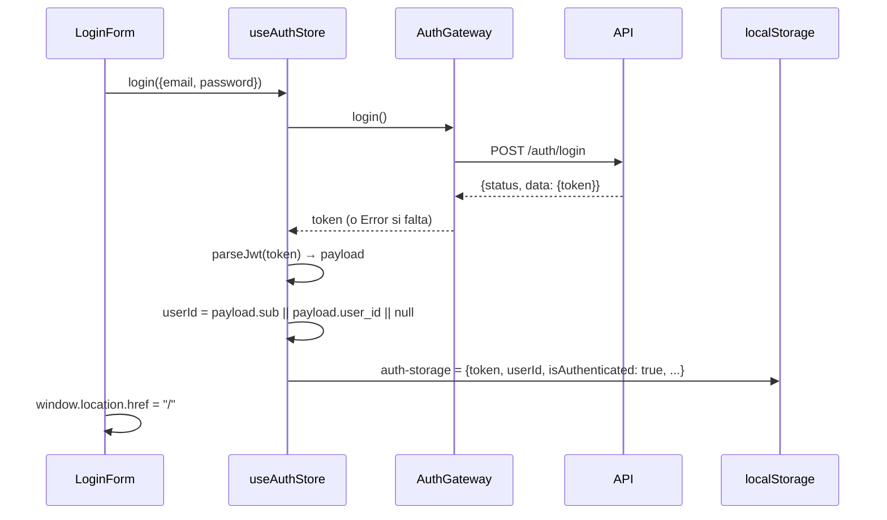

# Autenticación en el frontend

Resumen: el front obtiene un JWT en el login, lo guarda en `localStorage`, saca de él el `user_id` y lo envía en `Authorization` en cada petición del navegador. **La API no valida ese token** (ver [security.md](../../virtual-catalog-api/docs/security.md#estado-actual-de-la-autorización) del backend): lo que realmente identifica al usuario es el `user_id` que el front pone en la ruta del carrito y del checkout.

## Obtener la sesión



- `AuthGateway.login` devuelve `response.data.token` y lanza `Error('El servidor no devolvió un token válido')` si no viene.
- `AuthGateway.register` devuelve `response.data.user_id`, pero el store lo descarta: después del registro hace un login con las mismas credenciales y toma el `userId` del token.
- `parseJwt` decodifica la parte central del JWT (base64url → JSON) **sin verificar la firma**. Si falla devuelve `null`, y en ese caso `userId` queda `null` aunque `isAuthenticated` sea `true`.

El backend firma el token con `HS256` e incluye `sub` (ID del usuario), `iat` y `exp` (60 minutos).

## Enviar el token

`httpClient` añade el header en todas las peticiones:

```ts
const token = useAuthStore.getState().token;
if (token) headers['Authorization'] = `Bearer ${token}`;
```

| Dónde se hace la petición | ¿Lleva `Authorization`? |
| --- | --- |
| Navegador, con sesión | Sí, en todas (incluidas las públicas, como la búsqueda) |
| Navegador, sin sesión | No |
| Servidor (SSR) | **Nunca**: en Node el store no tiene acceso a `localStorage`, el token es `null` |

Como la sesión solo existe en el navegador, las páginas SSR no saben quién es el usuario. Esto encaja con lo que hoy cargan (catálogo, artículo y una orden por su ID, que no requieren usuario), pero impide, por ejemplo, proteger `/checkout/:id` en el servidor.

## Uso del `userId`

| Componente | Uso |
| --- | --- |
| `CartWidget` | Si `isAuthenticated && userId`, `fetchCart(userId)` al montarse |
| `AddToCartButton`, `ArticleCard` | Sin sesión o sin `userId` → `window.location.href = '/login'`; si no, `addItem(userId, ...)` |
| `CartSidebar` | Sin `userId`, "Finalizar Compra" redirige a `/login` y los botones +/–/Eliminar no hacen nada |
| `AuthWidget` | Muestra "Login" o "Salir" según `isAuthenticated` |

## Cerrar sesión

"Salir" (`AuthWidget`) llama a `logout()`, que borra `token`, `userId` e `isAuthenticated` (el `persist` lo refleja en `localStorage`), y hace `window.location.href = '/'`. La recarga completa también vacía `useCartStore`, que solo vive en memoria. No hay llamada a la API, porque el backend no tiene endpoint de logout.

## Lo que no hay

- **Rutas protegidas**: ninguna página exige sesión. `/checkout/:id` se puede abrir sin estar logueado; la protección es solo de UI (botones que redirigen a `/login`).
- **Expiración**: nunca se mira `exp`. Una sesión queda "abierta" en el navegador indefinidamente; como la API no valida el token, todo sigue funcionando después de los 60 minutos.
- **Renovación (refresh token)** ni manejo de `401`: `httpClient` trata cualquier error igual.
- **Cookies**: el token no viaja en cookie, así que el SSR no puede leerlo.
- **Redirección de vuelta**: tras el login siempre se va a `/`, no a la página anterior.

Si el backend empieza a validar el JWT (pasos en [security.md](../../virtual-catalog-api/docs/security.md#estado-actual-de-la-autorización)), el front ya envía el header. Faltaría manejar `401` (cerrar sesión y redirigir) y, si se quiere SSR autenticado, mover el token a una cookie.

Riesgos de guardar el JWT en `localStorage` (accesible desde cualquier script de la página) y el resto de limitaciones en [known-issues.md](known-issues.md).
