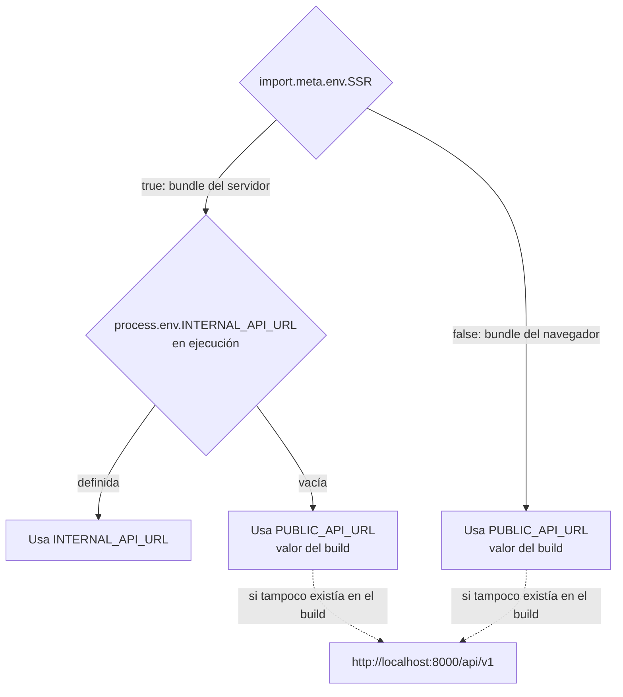
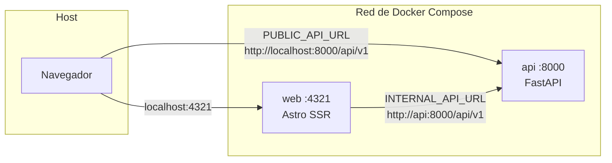

# Configuración

El frontend solo necesita saber **dónde está la API**. Para eso usa dos variables, porque las peticiones salen desde dos lugares distintos: el servidor de Astro (SSR) y el navegador del usuario.

## Variables de entorno

| Variable | La usa | Se resuelve | Dónde se define | Por defecto |
| --- | --- | --- | --- | --- |
| `PUBLIC_API_URL` | Navegador (y servidor como respaldo) | **En el build** (se incrusta en el bundle) | `.env` en local; `ARG` del `Dockerfile` en Docker | `http://localhost:8000/api/v1` |
| `INTERNAL_API_URL` | Solo servidor (SSR) | **En ejecución** (`process.env`) | Entorno del proceso; `environment` del `docker-compose.yml` | Ninguno (cae en `PUBLIC_API_URL`) |
| `HOST` | Servidor Node standalone | En ejecución | `Dockerfile` (`0.0.0.0`) | `localhost` |
| `PORT` | Servidor Node standalone | En ejecución | `Dockerfile` (`4321`) | `4321` |

Ambas URLs deben incluir el prefijo `/api/v1` y **no** terminar en `/`: los gateways concatenan rutas que empiezan por `/` (`${BASE_URL}/cart/...`).

## Cómo elige la URL `httpClient`

```ts
// src/shared/lib/httpClient.ts
const BASE_URL = import.meta.env.SSR
  ? process.env.INTERNAL_API_URL ||
    import.meta.env.PUBLIC_API_URL ||
    'http://localhost:8000/api/v1'
  : import.meta.env.PUBLIC_API_URL || 'http://localhost:8000/api/v1';
```



Qué hace Vite/Astro con cada parte durante `npm run build` (comprobado inspeccionando `dist/`):

- `import.meta.env.SSR` se reemplaza por `true` o `false`, de modo que cada bundle solo conserva su rama.
- `import.meta.env.PUBLIC_API_URL` se reemplaza por **el texto literal** que tenía la variable al compilar, tanto en el bundle del navegador como en el del servidor.
- `process.env.INTERNAL_API_URL` se mantiene como código y se lee al arrancar el servidor. No aparece en el bundle del navegador.

En el servidor compilado queda algo como:

```js
const BASE_URL = process.env.INTERNAL_API_URL || "<PUBLIC_API_URL del build>";
```

Consecuencias prácticas:

- **Cambiar `PUBLIC_API_URL` exige recompilar.** Definirla al ejecutar `node ./dist/server/entry.mjs` o en el `environment` de Docker no tiene efecto.
- **`INTERNAL_API_URL` se puede cambiar sin recompilar**, solo reiniciando el servidor.
- `BASE_URL` se calcula una vez, al cargar el módulo.
- El código lee `INTERNAL_API_URL` de `process.env`, así que defínela como variable de entorno real del proceso (shell, Docker). No la pongas en `.env` esperando que funcione: ese archivo es para las variables `PUBLIC_*` que lee Astro.

### ¿Por qué dos URLs?

Dentro de Docker Compose, el contenedor `web` llega a la API por la red interna (`http://api:8000`), pero el navegador del usuario corre en el host y solo conoce `http://localhost:8000`. Una sola URL no sirve para los dos.



Las peticiones SSR no pasan por CORS (no interviene el navegador). Las del navegador sí: la API solo acepta los orígenes de `CORS_ORIGINS` (en el compose, `["http://localhost:4321"]`). Si abres el front como `http://127.0.0.1:4321` o en otro puerto, el navegador bloqueará las llamadas a la API hasta que agregues ese origen (ver [configuration.md](../../virtual-catalog-api/docs/configuration.md) del backend).

## Archivo `.env`

Existe `shoes-web-app/.env` con `PUBLIC_API_URL`. Astro lo lee en `npm run dev` y `npm run build`.

```dotenv
PUBLIC_API_URL=http://localhost:8000/api/v1
```

- Está en `.gitignore` y en `.dockerignore`: no se versiona ni se copia a la imagen de Docker. En Docker el valor llega por el build arg.
- No hay `.env.example` en el frontend; usa el bloque anterior como referencia.
- Todo lo que empiece por `PUBLIC_` termina en el JavaScript público. **No pongas secretos** en variables `PUBLIC_*`.
- `src/env.d.ts` solo referencia los tipos de Astro; `PUBLIC_API_URL` no está declarada en una interfaz `ImportMetaEnv`, así que TypeScript la trata como `any`.

## Valores por entorno

| Entorno | `PUBLIC_API_URL` | `INTERNAL_API_URL` |
| --- | --- | --- |
| `npm run dev` | `.env` | No hace falta: el servidor usa `PUBLIC_API_URL` |
| `npm run build` + `node ./dist/server/entry.mjs` | `.env` (al compilar) | Opcional, en el entorno al ejecutar |
| Docker Compose (raíz del monorepo) | `http://localhost:8000/api/v1` (build arg) | `http://api:8000/api/v1` |

## Adapter de Node

`astro.config.mjs`:

```js
export default defineConfig({
  integrations: [react()],
  adapter: node({ mode: "standalone" }),
  vite: { plugins: [tailwindcss()] },
});
```

| Opción | Efecto |
| --- | --- |
| `integrations: [react()]` | Permite componentes `.tsx` como islas (`@astrojs/react`) |
| `adapter: node({ mode: "standalone" })` | El build genera un servidor HTTP propio en `dist/server/entry.mjs` (no hace falta Express). Sirve también los estáticos de `dist/client/` |
| `output` (no definido) | Vale `static`: se prerenderizan las páginas salvo las que declaran `export const prerender = false` |
| `vite.plugins: [tailwindcss()]` | Tailwind 4 vía su plugin de Vite (no hay `tailwind.config.*`) |

Al compilar, el adapter muestra `Enabling sessions with filesystem storage`: activa por defecto las sesiones de Astro con almacenamiento en disco, aunque el código no las usa.

`tsconfig.json` extiende `astro/tsconfigs/strict` y configura `jsx: react-jsx` con `jsxImportSource: react`.

Instrucciones para compilar y ejecutar en [development.md](development.md).
