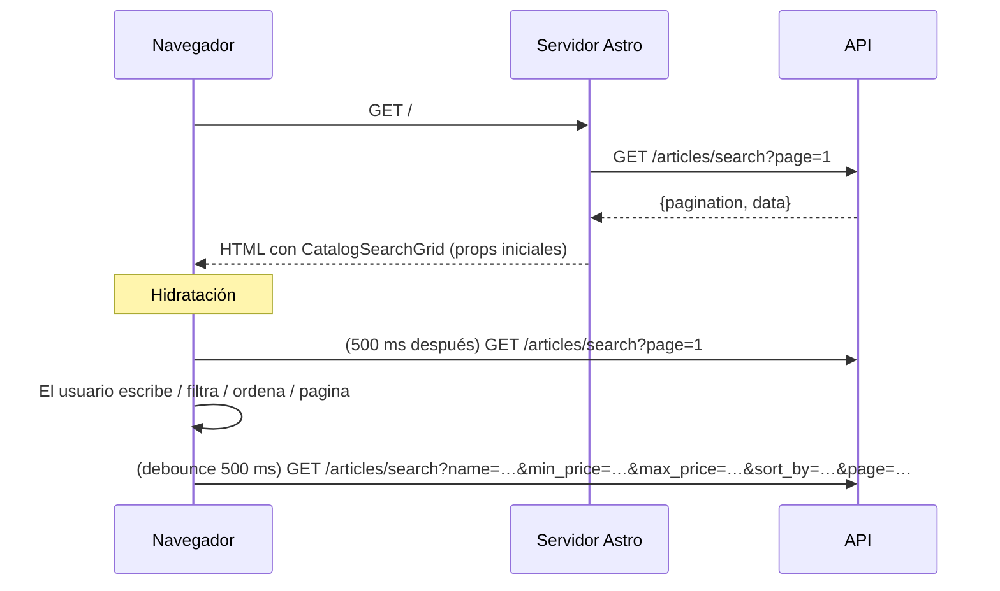
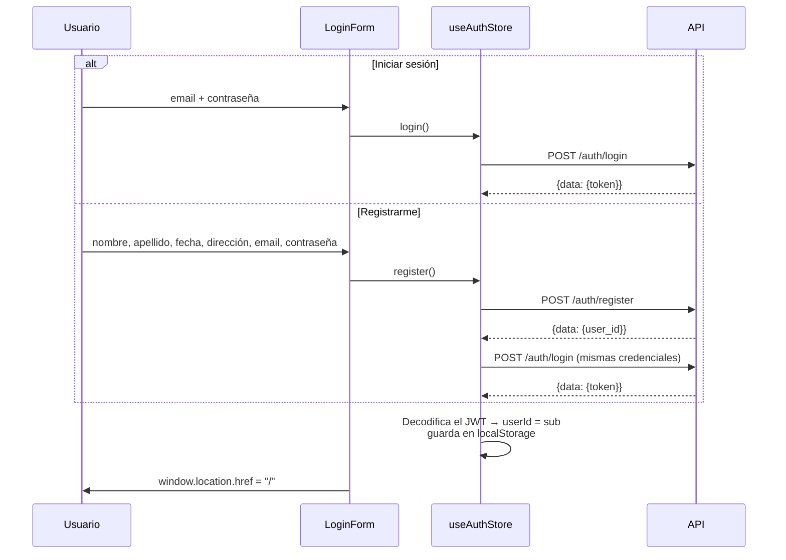
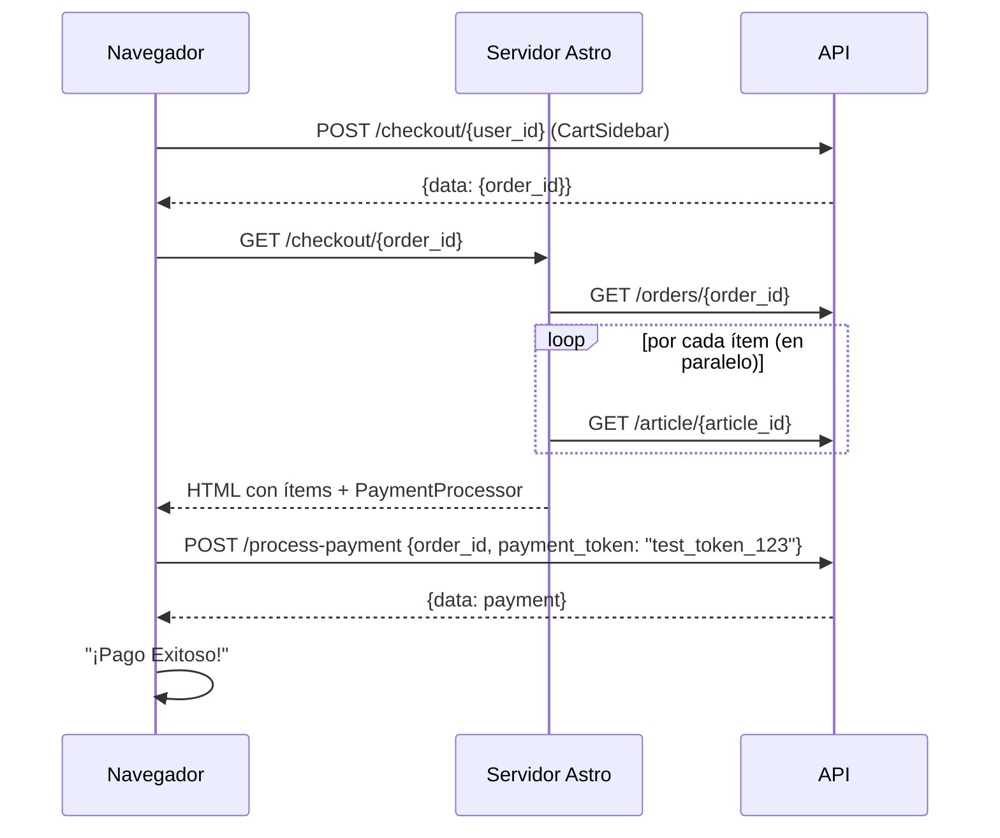

# Páginas y flujos

Cada archivo de `src/pages/` es una ruta. Esta página describe qué carga cada una en el servidor y en el navegador, y qué endpoints de la API llama. Las rutas de la API son relativas a la base `/api/v1` (ver [api-reference.md](../../virtual-catalog-api/docs/api-reference.md) del backend).

| Ruta | Archivo | Renderizado | Layout |
| --- | --- | --- | --- |
| `/` | `src/pages/index.astro` | SSR (`prerender = false`) | `MainLayout` |
| `/article/:id` | `src/pages/article/[id].astro` | SSR (`prerender = false`) | `MainLayout` |
| `/checkout/:id` | `src/pages/checkout/[id].astro` | SSR (`prerender = false`) | `MainLayout` |
| `/login` | `src/pages/login.astro` | Estática (prerender en el build) | Propio |

No hay página de carrito: el carrito es un panel lateral (`CartSidebar`) presente en todas las páginas con `MainLayout`. Tampoco hay página 404 personalizada, ni rutas de perfil, historial de pedidos o administración.

## Elementos comunes (`MainLayout`)

En cada página con `MainLayout`, al hidratar:

- **`AuthWidget`** lee `isAuthenticated` de `useAuthStore` (persistido en `localStorage`). Muestra "Login" (enlace a `/login`) o "Salir" (borra la sesión y recarga `/`).
- **`CartWidget`**, si hay sesión, llama a `fetchCart(userId)` → `GET /cart/{user_id}`. Muestra un globo con la suma de cantidades y abre el sidebar al hacer clic.
- **`CartSidebar`** muestra el carrito del store. Ver [Carrito](#carrito-sidebar).

Por lo tanto, **cada carga de página con sesión hace un `GET /cart/{user_id}`** desde el navegador.

## `/` — Catálogo

**Servidor.** El frontmatter llama a `CatalogGateway.searchCatalog({ page: 1 })` y pasa `items` y `pagination` como props a `CatalogSearchGrid`. Si la petición falla, muestra "No pudimos conectar con el almacén. Intenta más tarde." y **no monta la grilla** (no hay forma de reintentar sin recargar).

**Navegador.** `CatalogSearchGrid` guarda en estado local de React: `searchTerm`, `minPrice`, `maxPrice`, `sortBy`, `page`, `articles`, `pagination` e `isLoading`. Un `useEffect` que depende de los filtros y la página lanza la búsqueda con un **debounce de 500 ms** (un `setTimeout` que se cancela si cambian los valores antes).

| Control | Query param | Notas |
| --- | --- | --- |
| Texto "Buscar" | `name` | Se omite si está vacío |
| "Precio Min ($)" | `min_price` | Se convierte con `Number()`; `0` se omite (es falsy) |
| "Precio Max ($)" | `max_price` | Igual que el mínimo |
| "Ordenar" | `sort_by` | `""` (Relevancia, se omite), `price_asc`, `price_desc` |
| Anterior / Siguiente | `page` | Cambiar cualquier filtro vuelve a `page = 1` |

- El encabezado muestra `pagination.total_records` "productos encontrados".
- Los botones de paginación solo aparecen si `pagination.total_pages > 1`. Con el bug actual del backend (`total_pages` siempre 1), **nunca aparecen** (ver [known-issues.md](known-issues.md)).
- Si la búsqueda en el navegador falla, solo se registra en consola (`console.error`) y la grilla mantiene los resultados anteriores.
- El efecto también se ejecuta al montar, así que la página 1 se pide **dos veces**: una en el servidor y otra en el navegador.

Cada resultado se pinta con `ArticleCard`: imagen (`image_urls[0]`), etiqueta fija "Running", nombre, precio en COP y un botón "+". La tarjeta entera es un enlace a `/article/{id}`. El botón "+" hace `preventDefault` y:

- sin sesión → redirige a `/login`;
- con sesión → `useCartStore.addItem(userId, id, 1)` (ver [Carrito](#carrito-sidebar)).

## `/article/:id` — Detalle de artículo

**Servidor.** Lee `id` de `Astro.params` y llama a `CatalogGateway.getArticleById(id)` → `GET /article/{id}` (en singular). Si falla (por ejemplo `404`), muestra "Artículo no encontrado o fuera de inventario." con un enlace al catálogo. El título de la pestaña es `"{nombre} | NovaRun"` o `"Error"`. La respuesta HTTP es **200 incluso en el caso de error** (no se usa `Astro.response.status`).

Con el artículo, renderiza en el servidor: nombre, precio formateado con `Intl.NumberFormat("es-CO")` usando `article.price.currency`, descripción y "Stock disponible: N unidades".

**Navegador.** Dos islas:

- `ImageGallery` (`images = article.image_urls`): imagen principal y hasta 5 miniaturas; clic en una miniatura cambia la principal. Sin imágenes usa `/placeholder-shoe.png`.
- `AddToCartButton` (`articleId`, `stock`): deshabilitado y con texto "Agotado" si `stock <= 0`. Sin sesión redirige a `/login`; con sesión llama a `addItem(userId, articleId, 1)` y muestra el `error` del store del carrito si lo hay.

El stock mostrado es el del momento del render en servidor; no se actualiza al agregar al carrito.

## `/login` — Inicio de sesión y registro

Página estática: el HTML se genera en el build y no llama a la API desde el servidor. La isla `LoginForm` tiene dos pestañas.

- **Login** envía `{email, password}`.
- **Registro** envía `first_name`, `last_name`, `birth_date` (input `date`, formato `YYYY-MM-DD`), `email`, `password` y `shipping_address {street, city, country, zip_code}`. Si el registro funciona, inicia sesión automáticamente con las mismas credenciales.
- Mientras `isLoading` es verdadero el botón muestra "Procesando...". Si falla, se muestra `error` del store.
- Si después de la acción `isAuthenticated` es verdadero, redirige a `/`. No vuelve a la página de la que venía el usuario.

Detalles del token y la sesión en [auth.md](auth.md).

## Carrito (sidebar)

El carrito no es una ruta: es `CartSidebar`, un panel fijo a la derecha que se abre con `toggleSidebar` (clic en el icono del carrito, en el overlay o en "Cerrar ✕"). Su estado está en `useCartStore` ([state-management.md](state-management.md)).

| Acción en la UI | Store | Endpoint |
| --- | --- | --- |
| Abrir página con sesión | `fetchCart` | `GET /cart/{user_id}` |
| "+" en una tarjeta o "Agregar al Carrito" | `addItem(userId, articleId, 1)` y luego `fetchCart` | `POST /cart/{user_id}/items` + `GET /cart/{user_id}` |
| "+" en el sidebar | `changeQuantity(userId, id, qty + 1)` y luego `fetchCart` | `PATCH /cart/{user_id}/items/{article_id}` + `GET` |
| "–" en el sidebar (cantidad > 1) | `changeQuantity(userId, id, qty - 1)` | `PATCH` + `GET` |
| "🗑️" (cantidad = 1) o "Eliminar" | `removeItem(userId, id)` | `DELETE /cart/{user_id}/items/{article_id}` + `GET` |
| "Finalizar Compra" | `checkout(userId)` | `POST /checkout/{user_id}` |

- `addItem` abre el sidebar automáticamente.
- Tras cada mutación se vuelve a pedir el carrito completo; no hay actualización optimista.
- El sidebar muestra nombre, imagen, subtotal y cantidad que devuelve la API (precios actuales de cada artículo), y el "Total estimado" (`cart.total_amount`).
- Los errores de agregar/cambiar/eliminar se guardan en `useCartStore.error`, pero **el sidebar no los muestra**; solo muestra los errores del checkout.

## `/checkout/:id` — Resumen de orden y pago

Se llega aquí desde el sidebar: tras un `POST /checkout/{user_id}` exitoso, el store limpia el carrito local, cierra el panel y el sidebar navega a `/checkout/{order_id}`.

**Servidor.**

1. `OrderGateway.getOrderById(id)` → `GET /orders/{id}`. Si falla, muestra "No pudimos cargar la orden. Puede que no exista o haya expirado." (con HTTP 200).
2. La orden solo trae `article_id`, cantidades y precios, así que la página **enriquece** cada ítem con `CatalogGateway.getArticleById` (`Promise.all`, una petición por ítem) para obtener nombre e imagen. Si un artículo ya no existe, usa "Artículo Técnico ({id})" y `/placeholder-shoe.png`.
3. Renderiza la lista (cantidad × precio unitario, subtotal) y "Order Ref: {order_id}". Montos en COP.

**Navegador.** `PaymentProcessor` (`orderId`, `totalAmount`) muestra el total, una tarjeta simulada "**** 4242" y el botón "Pagar". Al pulsarlo envía `POST /process-payment` con `payment_token` fijo `"test_token_123"`:

- Con el adaptador **mock** del backend, cualquier token distinto de `tok_declined`, `tok_insufficient_funds` y `tok_timeout` se aprueba, así que el pago siempre es exitoso.
- Con el adaptador **Stripe**, `test_token_123` no es un `PaymentMethod` válido y el pago falla (ver [payments.md](../../virtual-catalog-api/docs/payments.md) del backend).
- En error muestra un mensaje genérico ("Hubo un error con el pago...") y registra el error con `console.log`.
- En éxito reemplaza el panel por "¡Pago Exitoso!" y un enlace al catálogo.

La página **no muestra ni comprueba el estado de la orden** (`PENDING`/`PAID`): una orden ya pagada vuelve a ofrecer el botón "Pagar". Ver [known-issues.md](known-issues.md).
