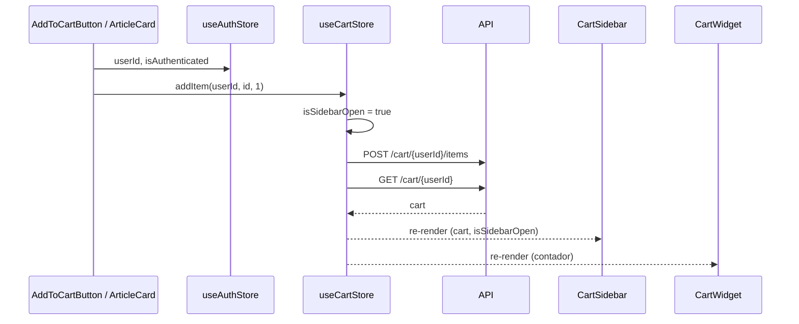

# Estado global (Zustand)

El estado compartido entre islas vive en dos stores de **Zustand 5**. El resto del estado es local de cada componente (`useState`).

| Store | Archivo | Persistencia | Contenido |
| --- | --- | --- | --- |
| `useAuthStore` | `src/modules/auth/store/useAuthStore.ts` | `localStorage`, clave `auth-storage` | Token, `userId`, estado de login |
| `useCartStore` | `src/modules/cart/store/useCartStore.ts` | Ninguna (memoria) | Carrito traído de la API y estado del sidebar |

El catálogo no tiene store: los filtros, la página y los resultados son estado local de `CatalogSearchGrid`, y se pierden al recargar (no se reflejan en la URL).

## `useAuthStore`

| Campo / acción | Tipo | Descripción |
| --- | --- | --- |
| `token` | `string \| null` | JWT devuelto por `POST /auth/login` |
| `userId` | `string \| null` | Claim `sub` (o `user_id`) del JWT, decodificado en el cliente |
| `isAuthenticated` | `boolean` | `true` tras un login correcto |
| `isLoading` | `boolean` | Petición de login/registro en curso |
| `error` | `string \| null` | Mensaje del último error |
| `login(credentials)` | `Promise<void>` | `AuthGateway.login` → decodifica → guarda |
| `register(userData)` | `Promise<void>` | `AuthGateway.register` y después `AuthGateway.login` |
| `logout()` | `void` | Pone `token`, `userId` a `null` e `isAuthenticated` a `false` |

Las acciones **no lanzan excepciones**: capturan el error y lo dejan en `error`. Por eso `LoginForm` comprueba `useAuthStore.getState().isAuthenticated` después de `await login(...)` para decidir si redirige.

### Persistencia

El store usa el middleware `persist` con la configuración mínima (`{ name: 'auth-storage' }`):

- Almacenamiento: `localStorage` (el predeterminado de Zustand), serializado como JSON.
- Se persiste **todo el estado** (no hay `partialize`): `token`, `userId`, `isAuthenticated`, pero también `isLoading` y `error`. Un error de login queda guardado y vuelve a aparecer al abrir `/login` en otra visita, hasta que se haga otro intento.
- No hay `version` ni `migrate`: si cambia la forma del estado, los datos viejos se fusionan tal cual.
- No se comprueba la expiración (`exp`) del token al rehidratar.

Ejemplo de lo que queda en `localStorage`:

```json
{
  "state": {
    "token": "eyJhbGciOi...",
    "userId": "3f6c...",
    "isAuthenticated": true,
    "isLoading": false,
    "error": null
  },
  "version": 0
}
```

Más detalles sobre el token en [auth.md](auth.md).

## `useCartStore`

| Campo / acción | Descripción | Endpoints |
| --- | --- | --- |
| `cart` | `Cart \| null`: `user_id`, `total_amount`, `items[]` | — |
| `isLoading` | Operación de carrito en curso (uno solo para todas) | — |
| `error` | Mensaje del último error | — |
| `isSidebarOpen` | Si el panel lateral está abierto | — |
| `toggleSidebar()` | Abre/cierra el panel | — |
| `fetchCart(userId)` | Trae el carrito | `GET /cart/{user_id}` |
| `addItem(userId, articleId, qty)` | Abre el sidebar, agrega y vuelve a traer el carrito | `POST /cart/{user_id}/items` + `GET` |
| `changeQuantity(userId, articleId, qty)` | Fija la cantidad y vuelve a traer el carrito | `PATCH /cart/{user_id}/items/{article_id}` + `GET` |
| `removeItem(userId, articleId)` | Quita y vuelve a traer el carrito | `DELETE /cart/{user_id}/items/{article_id}` + `GET` |
| `clearCart(userId)` | Vacía el carrito (ningún componente lo usa) | `DELETE /cart/{user_id}/items` |
| `checkout(userId)` | Crea la orden, limpia `cart` y cierra el sidebar. Devuelve `order_id` | `POST /checkout/{user_id}` |

- La fuente de verdad es la API: tras cada mutación se pide el carrito completo (no hay actualización optimista).
- `checkout` es la única acción que **relanza** el error, para que `CartSidebar` lo muestre. Las demás lo guardan en `error`.
- `addItem` no limpia `error` al empezar (las otras acciones sí), así que un error anterior puede seguir visible.
- El store no recibe el usuario por sí mismo: cada componente lee `userId` de `useAuthStore` y lo pasa como argumento.
- Como no se persiste, el carrito se vuelve a pedir en cada carga de página (lo hace `CartWidget` al montarse).

## Flujo entre islas



Todas las islas importan el mismo módulo del store, y el navegador lo carga una sola vez, así que el estado es compartido aunque cada isla sea una raíz de React distinta.

## Hidratación

Las islas se renderizan primero en el servidor, donde los stores tienen su estado inicial (sin sesión, `cart = null`). En el navegador, `persist` rehidrata `useAuthStore` desde `localStorage` al crear el store, antes del primer render. Si un componente pintara algo distinto según la sesión, el HTML del servidor no coincidiría con el del cliente.

- `AuthWidget` lo evita renderizando un hueco vacío hasta que `useEffect` marca `isMounted = true`.
- `CartWidget`, `CartSidebar`, `AddToCartButton` y `ArticleCard` leen la sesión, pero su primer render no depende de ella (`cart` es `null` en ambos lados, y la sesión solo se usa en handlers y efectos).

En el servidor, `useAuthStore` es un singleton del proceso Node compartido por todas las peticiones. Hoy no es un problema porque nadie llama a `login` en el servidor (el token siempre es `null` en SSR), pero no conviene guardar ahí datos de un usuario.
