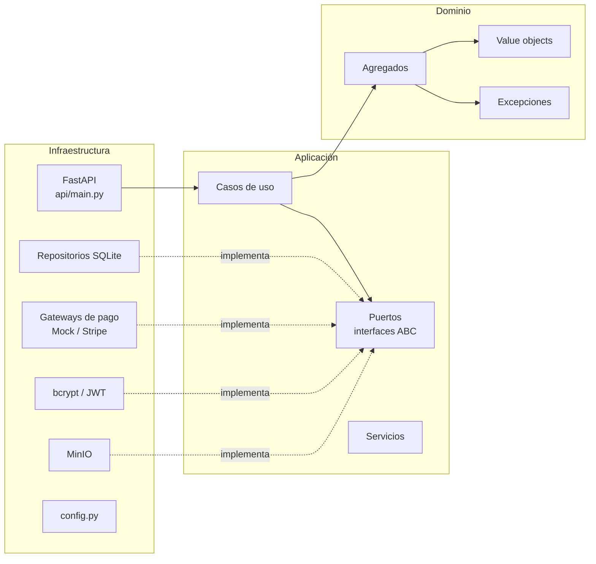
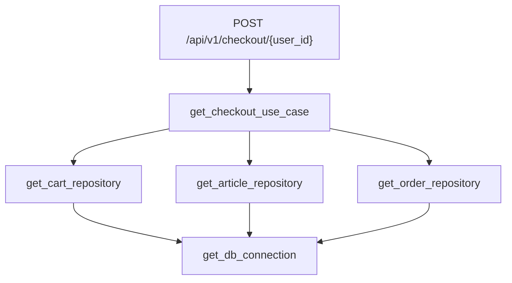
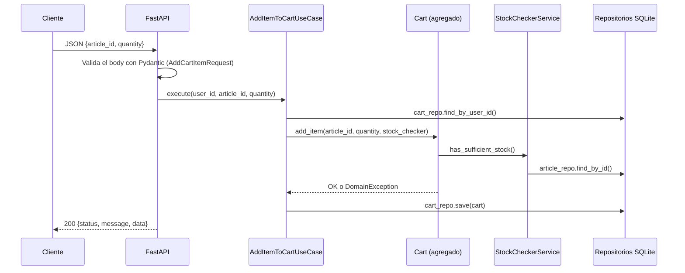

# Arquitectura

La API sigue una **arquitectura hexagonal (puertos y adaptadores)** con ideas de **Domain-Driven Design**. El código se divide en tres capas con una regla de dependencia estricta: las capas internas no conocen a las externas.



| Capa | Carpeta | Responsabilidad | Depende de |
| --- | --- | --- | --- |
| Dominio | `app/domain/` | Reglas de negocio puras: agregados, value objects y excepciones. Sin librerías externas. | Nada |
| Aplicación | `app/application/` | Orquesta los casos de uso y define los **puertos** (interfaces) que necesita del exterior. | Dominio |
| Infraestructura | `app/infrastructure/` | Implementa los puertos (**adaptadores**): SQLite, MinIO, Stripe, bcrypt, JWT. Expone la API HTTP. | Aplicación y dominio |

## Estructura de carpetas

```
app/
├── domain/
│   ├── aggregates/        # Article, Cart, Order, Payment, User
│   ├── value_objects/     # Price, Stock, Email, BirthDate, ShippingAddress, ImageURL, CartItem, OrderItem
│   ├── services/          # ArticleStockChecker (interfaz de servicio de dominio)
│   └── exceptions.py      # DomainException, InvalidCredentialsException
├── application/
│   ├── ports/             # Interfaces: repositorios, PaymentGateway, FileStoragePort, PasswordHasher, TokenGenerator
│   ├── use_cases/         # Un archivo por caso de uso (register_user, checkout, process_payment, ...)
│   ├── services/          # StockCheckerService (implementa ArticleStockChecker usando el repositorio)
│   ├── queries/           # ArticleCriteria (criterios de búsqueda)
│   └── dtos/              # CartDTO, CartItemDTO (datos de salida de get_cart)
└── infrastructure/
    ├── api/main.py        # App FastAPI: esquemas, inyección de dependencias, manejadores de error y endpoints
    ├── config.py          # Settings (pydantic-settings)
    ├── repositories/      # Sqlite*Repository + mappers/ (dominio <-> fila SQL)
    ├── gateways/          # MockPaymentGateway, StripePaymentGateway
    ├── security/          # BcryptPasswordHasher, JwtTokenGenerator
    └── storage/           # MinioFileStorage
```

> `app/main.py` es un archivo de ejemplo ("Hello, World!") que no se usa. El punto de entrada real es `app/infrastructure/api/main.py`.

## Puertos y adaptadores

Los casos de uso solo conocen interfaces (`abc.ABC`). La infraestructura aporta la implementación concreta:

| Puerto (`app/application/ports/`) | Adaptador (`app/infrastructure/`) |
| --- | --- |
| `UserRepository` | `repositories/sqlite_user_repository.py` |
| `ArticleRepository` | `repositories/sqlite_article_repository.py` |
| `CartRepository` | `repositories/sqlite_cart_repository.py` |
| `OrderRepository` | `repositories/sqlite_order_repository.py` |
| `PaymentRepository` | `repositories/sqlite_payment_repository.py` |
| `PaymentGateway` | `gateways/mock_payment_gateway.py`, `gateways/stripe_payment_gateway.py` |
| `FileStoragePort` | `storage/minio_file_storage.py` |
| `PasswordHasher` | `security/bcrypt_password_hasher.py` |
| `TokenGenerator` | `security/jwt_generator.py` |

Hay además un puerto **de dominio**: `ArticleStockChecker` (`app/domain/services/`). El agregado `Cart` lo recibe para validar stock sin depender de un repositorio. `StockCheckerService` (capa de aplicación) lo implementa consultando el `ArticleRepository`.

Gracias a esta separación, cambiar SQLite por PostgreSQL o Stripe por otra pasarela solo requiere escribir un nuevo adaptador. Los casos de uso y el dominio no cambian. También permite probar los casos de uso con `MagicMock` en lugar de una base de datos real (ver [testing.md](testing.md)).

## Inyección de dependencias

`app/infrastructure/api/main.py` arma el grafo de objetos con `Depends` de FastAPI. Cada endpoint pide un caso de uso, y FastAPI resuelve en cadena lo que este necesita:



- `get_db_connection()` abre una conexión SQLite y la cierra al terminar la petición (es un generador con `yield`).
- FastAPI **cachea cada dependencia por petición**: todos los repositorios de una misma petición comparten la misma conexión.
- `get_payment_gateway()` elige el adaptador de pago según `PAYMENT_GATEWAY_PROVIDER` (ver [payments.md](payments.md)).
- `get_file_storage()` y los repositorios leen su configuración de `settings` (ver [configuration.md](configuration.md)).

## Recorrido de una petición

Ejemplo: agregar un artículo al carrito (`POST /api/v1/cart/{user_id}/items`).



Si alguna regla de negocio falla, el agregado lanza `DomainException` y un manejador global la convierte en una respuesta `400` (ver [errors-and-validation.md](errors-and-validation.md)).
