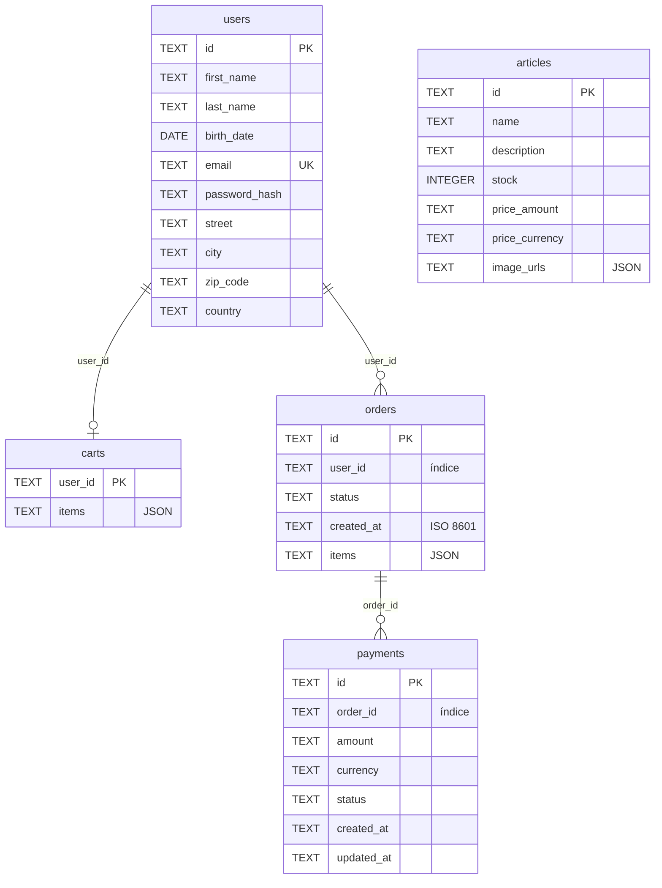

# Base de datos

La API usa **SQLite** con el módulo estándar `sqlite3` de Python, sin ORM. El acceso pasa siempre por repositorios que implementan los puertos de `app/application/ports/` (ver [architecture.md](architecture.md)).

## Ubicación del archivo

La ruta se configura con `DATABASE_PATH`. Si es relativa, se resuelve desde `virtual-catalog-api/`, y la carpeta se crea si no existe (ver [configuration.md](configuration.md)).

| Entorno | `DATABASE_PATH` recomendado | Archivo resultante |
| --- | --- | --- |
| Local | `data/catalogo.db` | `virtual-catalog-api/data/catalogo.db` |
| Docker | `data/catalogo.db` | `/app/data/catalogo.db`, dentro del volumen `api_data` |

La carpeta `data/` está en `.gitignore` y `.dockerignore`: la base de datos no se versiona ni se copia a la imagen.

## Esquema

No hay migraciones: cada repositorio crea su tabla con `CREATE TABLE IF NOT EXISTS` al instanciarse. La base de datos se crea sola la primera vez que se atiende una petición o se ejecuta el seed.



Las relaciones del diagrama son **lógicas**: no hay `FOREIGN KEY` declaradas, así que SQLite no las hace cumplir.

Decisiones de diseño:

- **Montos como `TEXT`** (`price_amount`, `amount`): guardan el `Decimal` como texto (`"150000.00"`) para no perder precisión. En la búsqueda se convierten con `CAST(price_amount AS REAL)` para filtrar y ordenar.
- **Colecciones como JSON en una columna**: cada agregado se guarda en una sola fila, en lugar de usar tablas hijas.
  - `articles.image_urls`: `["http://…/a.jpg", "http://…/b.jpg"]`
  - `carts.items`: `[{"article_id": "…", "quantity": 2}]`
  - `orders.items`: `[{"article_id": "…", "quantity": 2, "price_amount": "250000.00", "price_currency": "COP"}]`
- **Fechas en ISO 8601** (`datetime.isoformat()`), en UTC.
- **IDs**: los usuarios y artículos usan UUID4; los pedidos `ord-xxxxxxxx` y los pagos `pay-xxxxxxxx` (8 caracteres hexadecimales de un UUID).
- **Índices**: `idx_orders_user_id` e `idx_payments_order_id`, para buscar por usuario y por pedido.

## Repositorios y mappers

Cada repositorio (`app/infrastructure/repositories/sqlite_*_repository.py`):

1. Recibe una `sqlite3.Connection` y configura `row_factory = sqlite3.Row`, para acceder a las columnas por nombre.
2. Crea su tabla si no existe.
3. Usa un **mapper** (`repositories/mappers/`) para convertir entre el agregado de dominio y la fila SQL:
   - `to_persistence(agregado) -> tuple` arma los valores en el orden de las columnas.
   - `to_domain(row) -> agregado` reconstruye value objects y agregados; usa `reconstitute()` cuando existe, así no se repiten validaciones de creación.

Todas las consultas usan **parámetros `?`**, nunca concatenación de valores, lo que evita inyección SQL. La búsqueda arma dinámicamente las cláusulas `WHERE`, pero los valores siempre van como parámetros.

| Repositorio | Operaciones | Estrategia de escritura |
| --- | --- | --- |
| `SqliteUserRepository` | `save`, `find_by_id`, `find_by_email` | `INSERT` (el email es `UNIQUE`) |
| `SqliteArticleRepository` | `create`, `update`, `find_by_id`, `find_all`, `search` | `INSERT` / `UPDATE` |
| `SqliteCartRepository` | `save`, `find_by_user_id`, `delete_by_user_id` | Upsert: `INSERT … ON CONFLICT(user_id) DO UPDATE` |
| `SqliteOrderRepository` | `save`, `find_by_id`, `find_by_user_id` | Upsert; en conflicto **solo actualiza `status`** |
| `SqlitePaymentRepository` | `save`, `find_by_id`, `find_by_order_id` | Upsert; en conflicto actualiza `status` y `updated_at` |

Los ítems de un pedido son inmutables: una vez creado, solo cambia su estado.

## Ciclo de vida de la conexión

```python
def get_db_connection():
    conn = sqlite3.connect(settings.database_path, check_same_thread=False)
    try:
        yield conn
    finally:
        conn.close()
```

- Se abre **una conexión por petición HTTP** y se cierra al terminar, aunque haya error.
- Todos los repositorios de la petición comparten esa conexión, porque FastAPI cachea las dependencias por petición.
- `check_same_thread=False` es necesario porque FastAPI puede ejecutar la dependencia y el endpoint en hilos distintos.

## Transacciones

No hay manejo explícito de transacciones. **Cada método de escritura hace `commit()` inmediatamente.** Las operaciones de un solo agregado son atómicas, pero los casos de uso que escriben varias veces no:

**Checkout** (`CheckoutUseCase`), en orden:
1. Por cada ítem del carrito: `article.decrease_stock()` y `article_repository.update()` (un commit por artículo).
2. `order_repository.save()` (commit).
3. `cart.clear()` y `cart_repository.save()` (commit).

Si el paso 1 falla en el segundo artículo (por ejemplo, sin stock), el stock del primero **ya quedó descontado** y no se revierte.

**Pago** (`ProcessPaymentUseCase`):
1. Guarda el `Payment` en `PENDING` (commit).
2. Llama a la pasarela.
3. Guarda el `Payment` como `COMPLETED` o `FAILED` (commit) y, si fue exitoso, el `Order` como `PAID` (commit).

Guardar el pago en `PENDING` antes del cobro es intencional: deja registro del intento aunque la pasarela falle a mitad de camino.

Para hacer el checkout atómico habría que agrupar las escrituras en una sola transacción (por ejemplo, con `with conn:`) y quitar los `commit()` de los repositorios, o introducir una *Unit of Work*. Esta y otras limitaciones están en [known-issues.md](known-issues.md).

## Inspeccionar la base de datos

```bash
# Local
sqlite3 data/catalogo.db ".tables"
sqlite3 data/catalogo.db "SELECT id, name, stock, price_amount FROM articles LIMIT 5;"

# Docker (la imagen no trae el CLI de sqlite3; se usa Python)
docker compose exec api python -c "import sqlite3; c=sqlite3.connect('data/catalogo.db'); print(c.execute('SELECT COUNT(*) FROM articles').fetchone())"
```

Para empezar de cero: en local borra `data/catalogo.db`; en Docker ejecuta `docker compose down -v`, que elimina también el volumen de RustFS.
