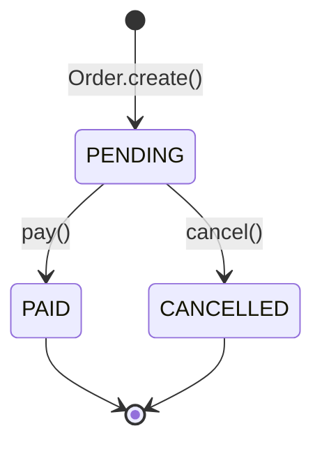
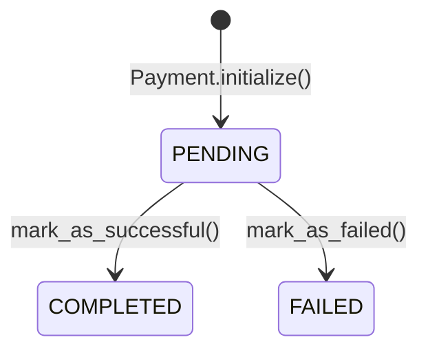
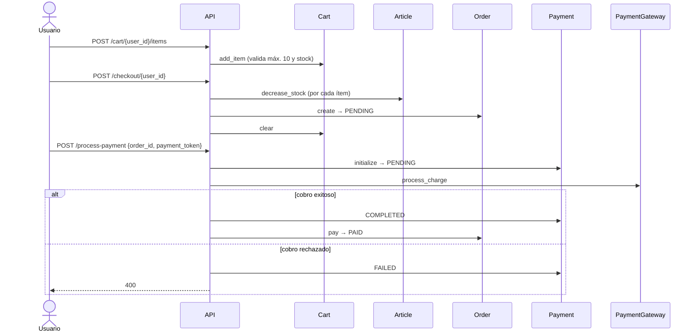

# Modelo de dominio

El dominio (`app/domain/`) contiene las reglas de negocio. No depende de FastAPI, SQLite ni de ninguna librería externa. Cuando una regla se incumple, lanza `DomainException`.

## Agregados

### `Article` — artículo del catálogo

`app/domain/aggregates/article.py`

| Campo | Tipo |
| --- | --- |
| `id` | `str` (UUID) |
| `name`, `description` | `str` |
| `price` | `Price` |
| `stock` | `Stock` |
| `image_urls` | `List[ImageURL]` |

Reglas:
- El nombre no puede estar vacío (`create`, `update_name`).
- Máximo **5 imágenes** por artículo (`attach_image`).
- `decrease_stock` / `sell_item` restan stock; `restock_item` lo aumenta. Las validaciones las hace `Stock`.

### `Cart` — carrito de un usuario

`app/domain/aggregates/cart.py`. Hay un carrito por usuario (`user_id`), con los ítems indexados por `article_id`.

Reglas:
- La cantidad a agregar debe ser mayor que cero.
- Máximo **10 unidades por artículo** (`MAX_UNITS_PER_ARTICLE`), sumando lo que ya hay en el carrito.
- Antes de agregar o cambiar una cantidad, consulta un `ArticleStockChecker` para verificar que haya stock suficiente.
- `change_item_quantity` exige que el artículo ya esté en el carrito y que la cantidad sea mayor que 0. Para quitarlo se usa `remove_item`.
- `remove_item` no falla si el artículo no está; `clear` vacía el carrito.

> Agregar al carrito **no reserva stock**: solo verifica que exista en ese momento. El stock se descuenta en el checkout.

### `Order` — pedido

`app/domain/aggregates/order.py`. Se crea en el checkout a partir del carrito.

- Debe tener al menos un ítem.
- Cada `OrderItem` **congela el precio unitario** del momento de la compra, así que cambios posteriores de precio no afectan el pedido.
- `total_amount` se calcula sumando los subtotales; toma la moneda del primer ítem.

- `pay()` solo es válido desde `PENDING`.
- `cancel()` falla si el pedido ya está `PAID` o `CANCELLED`. Hoy ningún endpoint lo usa.

### `Payment` — intento de pago

`app/domain/aggregates/payment.py`. Representa un intento de cobro de un pedido. Un pedido puede tener varios pagos, por ejemplo si el primero fue rechazado.

Las transiciones solo son válidas desde `PENDING`, y cada una actualiza `updated_at`.

### `User` — usuario registrado

`app/domain/aggregates/user.py`. Guarda nombre, apellido, `Email`, `BirthDate`, `password_hash` y `ShippingAddress`. La contraseña nunca se guarda en texto plano: llega ya hasheada desde el caso de uso (ver [security.md](security.md)).

## Value objects

Son objetos inmutables (o casi) que se validan al construirse, en `__post_init__`. Si un value object existe, es válido.

| Value object | Reglas |
| --- | --- |
| `Price(amount: Decimal, currency="COP")` | `amount >= 0`; moneda de exactamente 3 letras. `add()` solo suma precios de la misma moneda. Inmutable. |
| `Stock(value: int)` | `value >= 0`. `decrease(q)` falla si `q < 0` o `q > value`; `add(q)` exige `q > 0`. Devuelve un `Stock` nuevo. Inmutable. |
| `Email(value)` | Debe cumplir el patrón `algo@algo.algo`. |
| `BirthDate(value: date)` | No puede ser futura; la persona debe tener **18 años o más** (ver [known-issues.md](known-issues.md)). |
| `ShippingAddress(street, city, zip_code, country)` | Todos los campos son obligatorios; `zip_code` debe ser numérico y tener 5 dígitos o más. |
| `ImageURL(url)` | No vacía; debe tener esquema y host (`http://host/...`). |
| `CartItem(article_id, quantity)` | `quantity >= 1`. Inmutable; `change_quantity` devuelve uno nuevo. |
| `OrderItem(article_id, quantity, unit_price)` | `quantity > 0`. `subtotal = unit_price.amount * quantity`. Inmutable. |

Los montos usan `Decimal` para evitar errores de redondeo de `float`. En la base de datos se guardan como texto (ver [database.md](database.md)).

## Excepciones

`app/domain/exceptions.py`:

- `DomainException`: clase base de todos los errores de negocio.
- `InvalidCredentialsException(DomainException)`: credenciales de login inválidas.

Cómo se traducen a HTTP se explica en [errors-and-validation.md](errors-and-validation.md).

## Casos de uso

`app/application/use_cases/`. Cada uno es una clase con un método `execute`.

| Caso de uso | Qué hace |
| --- | --- |
| `RegisterUserUseCase` | Verifica que el email no exista, construye los value objects, hashea la contraseña y guarda el usuario. |
| `LoginUserUseCase` | Busca el usuario por email, verifica la contraseña y devuelve un JWT. |
| `CreateArticleUseCase` | Crea un `Article` con precio, stock y URLs de imágenes ya subidas. |
| `GetAllArticlesUseCase` / `GetArticleByIdUseCase` | Lectura de artículos. |
| `SearchArticleUseCase` | Traduce filtros y página a `ArticleCriteria` (20 resultados por página) y calcula la paginación. |
| `GetCartUseCase` | Devuelve el carrito (lo crea si no existe) enriquecido con nombre, precio, subtotal e imagen de cada artículo (`CartDTO`). |
| `AddItemToCartUseCase` / `ChangeItemQuantityUseCase` / `RemoveItemFromCartUseCase` / `ClearCartUseCase` | Operaciones sobre el carrito. |
| `CheckoutUseCase` | Convierte el carrito en un pedido `PENDING`, descuenta stock y vacía el carrito. |
| `GetOrderUseCase` | Obtiene un pedido por ID. |
| `ProcessPaymentUseCase` | Cobra un pedido a través del `PaymentGateway` configurado (ver [payments.md](payments.md)). |

## Flujo de compra completo

