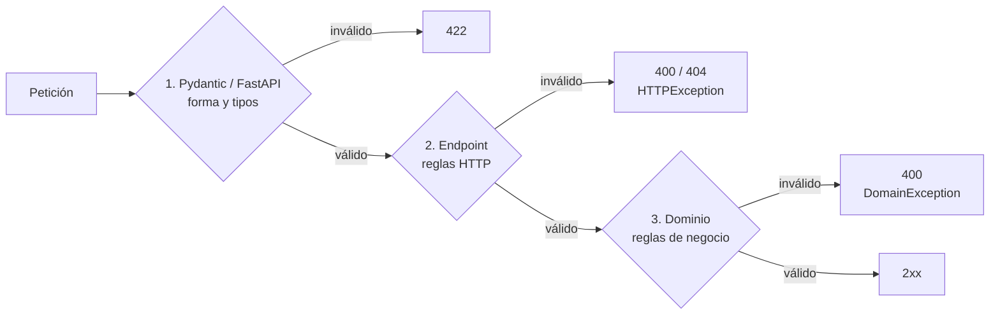

# Validación y manejo de errores

Los datos se validan en **tres niveles**. Cada uno atrapa un tipo distinto de error:



## 1. Esquemas de entrada (Pydantic)

Los modelos de `app/infrastructure/api/main.py` validan **forma y tipo** antes de ejecutar el endpoint:

| Esquema | Validaciones |
| --- | --- |
| `UserRegisterRequest` | Todos los campos obligatorios; `password` con `min_length=6`; `shipping_address` anidado (`AddressSchema`: `street`, `city` y `country` no vacíos) |
| `UserLoginRequest` | `email` y `password` obligatorios |
| `AddCartItemRequest` | `article_id` obligatorio; `quantity > 0` |
| `ChangeQuantityRequest` | `quantity > 0` |
| `ProcessPaymentRequest` | `order_id` y `payment_token` obligatorios |

Los parámetros de formulario y query también se validan: en `POST /articles`, `stock >= 0`, `price_amount > 0`, moneda de 3 letras; en la búsqueda, `page >= 1`.

Si algo falla, FastAPI responde automáticamente **`422 Unprocessable Entity`**:

```json
{
  "detail": [
    {
      "type": "greater_than",
      "loc": ["body", "quantity"],
      "msg": "Input should be greater than 0",
      "input": 0
    }
  ]
}
```

## 2. Validaciones en el endpoint

Algunas reglas se revisan dentro del endpoint y se responden con `HTTPException`:

- `POST /articles`: más de 5 imágenes, o archivos sin nombre o sin `Content-Type`, devuelven `400`.
- `GET /article/{id}`: si el artículo no existe, devuelve `404`.
- `POST /process-payment`: atrapa la `DomainException` del caso de uso y la convierte en `400`.

Formato:

```json
{ "detail": "Artículo con ID 'abc' no encontrado." }
```

## 3. Reglas de negocio (dominio)

Los value objects y agregados validan las reglas del negocio al construirse o modificarse, y lanzan `DomainException`. Por ejemplo: email inválido, menor de edad, código postal inválido, más de 10 unidades en el carrito, stock insuficiente o transición de estado no permitida. La lista completa está en [domain.md](domain.md).

Como el dominio se valida a sí mismo, las reglas se cumplen sin importar desde dónde se use: la API, el seed o los tests.

## Manejadores globales de excepciones

`main.py` registra dos manejadores:

| Excepción | Código | Cuerpo |
| --- | --- | --- |
| `DomainException`, incluida `InvalidCredentialsException` | `400` | `{"error": "DomainValidationError", "message": "..."}` |
| `ValueError` | `400` | `{"error": "ApplicationError", "message": "..."}` |

Se lanza `ValueError` cuando:
- se registra un email que ya existe (`RegisterUserUseCase`);
- el proveedor de pago no es válido o falta `STRIPE_SECRET_KEY` (`get_payment_gateway`);
- la fecha de nacimiento no tiene formato `YYYY-MM-DD` (`datetime.strptime`).

Cualquier otra excepción no controlada (por ejemplo `RuntimeError` de RustFS o `sqlite3.IntegrityError`) termina en **`500 Internal Server Error`**, con el traceback en los logs de Uvicorn.

## Resumen de formatos de error

Hoy conviven tres formatos, y el cliente debe manejar los tres:

| Origen | Código | Forma |
| --- | --- | --- |
| Validación de Pydantic | 422 | `{"detail": [ {...} ]}` |
| `HTTPException` | 400 / 404 | `{"detail": "texto"}` |
| `DomainException` / `ValueError` | 400 | `{"error": "...", "message": "texto"}` |

Unificarlos implicaría registrar manejadores para `HTTPException` y `RequestValidationError` que respondan también con `{"error", "message"}` (ver [known-issues.md](known-issues.md)).
