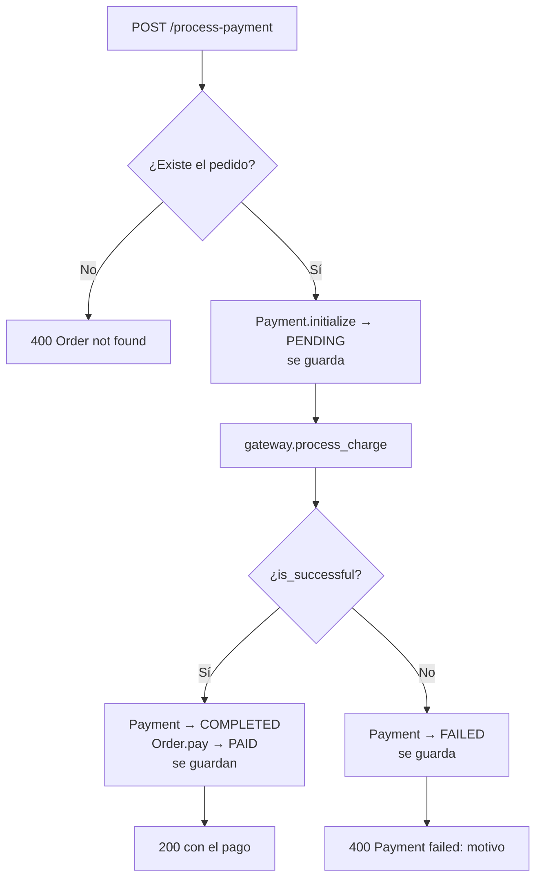

# Pagos

Los cobros pasan por el puerto `PaymentGateway` (`app/application/ports/payment_gateway.py`). Hay dos adaptadores: uno **mock** para desarrollo y pruebas, y otro real con **Stripe**.

```python
@dataclass
class GatewayResponse:
    is_successful: bool
    transaction_id: Optional[str]
    error_message: Optional[str]

class PaymentGateway(ABC):
    def process_charge(self, payment_id: str, amount: Price, payment_token: str) -> GatewayResponse: ...
```

La pasarela no lanza excepciones por un cobro rechazado: devuelve `is_successful=False` con un mensaje. El caso de uso decide qué hacer con esa respuesta.

## Elegir el adaptador

`get_payment_gateway()` en `app/infrastructure/api/main.py` lee `PAYMENT_GATEWAY_PROVIDER` en cada petición de pago:

| `PAYMENT_GATEWAY_PROVIDER` | Adaptador | Requiere |
| --- | --- | --- |
| `mock` | `MockPaymentGateway` | nada |
| `stripe` | `StripePaymentGateway` | `STRIPE_SECRET_KEY` |
| otro valor | — | responde `400 Unsupported payment provider` |

El valor no distingue mayúsculas de minúsculas. Si eliges `stripe` sin `STRIPE_SECRET_KEY`, el endpoint responde `400 STRIPE_SECRET_KEY variable is missing for Stripe provider.`

## Adaptador mock

`app/infrastructure/gateways/mock_payment_gateway.py`. No hace llamadas externas; el resultado depende del `payment_token`:

| `payment_token` | Resultado | Mensaje |
| --- | --- | --- |
| `tok_declined` | Rechazado | `Card declined by the issuing bank.` |
| `tok_insufficient_funds` | Rechazado | `Insufficient funds.` |
| `tok_timeout` | Rechazado (sin `transaction_id`) | `Gateway timeout. Please try again later.` |
| cualquier otro valor | **Aprobado** | — |

Genera IDs de transacción con el formato `txn_mock_xxxxxxxxxxxx`.

```bash
# Pago aprobado
curl -X POST http://localhost:8000/api/v1/process-payment \
  -H "Content-Type: application/json" \
  -d '{"order_id": "ord-1a2b3c4d", "payment_token": "tok_visa"}'

# Pago rechazado
curl -X POST http://localhost:8000/api/v1/process-payment \
  -H "Content-Type: application/json" \
  -d '{"order_id": "ord-1a2b3c4d", "payment_token": "tok_declined"}'
```

## Adaptador Stripe

`app/infrastructure/gateways/stripe_payment_gateway.py`, con la librería oficial `stripe`.

Crea y confirma un **PaymentIntent** en una sola llamada:

```python
stripe.PaymentIntent.create(
    amount=<monto en la unidad mínima>,
    currency="cop",
    payment_method=payment_token,          # ID de método de pago, ej. "pm_card_visa"
    confirm=True,
    automatic_payment_methods={"enabled": True, "allow_redirects": "never"},
    description="Charge for internal payment ID: pay-…",
    metadata={"internal_payment_id": "pay-…"},
)
```

- **`payment_token`** debe ser un ID de método de pago de Stripe. En modo prueba sirven los de la documentación de Stripe, como `pm_card_visa` (aprobado) o `pm_card_chargeDeclined` (rechazado). En producción lo genera el frontend con Stripe.js.
- **Monto**: el código trata `COP`, `CLP`, `JPY` y `KRW` como monedas sin decimales y envía el monto entero; para las demás multiplica por 100 (centavos). Revisa la lista de monedas de cero decimales de Stripe antes de usarlo en producción (ver [known-issues.md](known-issues.md)).
- **`allow_redirects: "never"`**: rechaza métodos que exijan redirección, como 3-D Secure con redirect. Si el intent queda en otro estado, se considera fallido.
- **Éxito**: estado `succeeded` o `requires_capture`.
- **Errores**:
  - `stripe.CardError` (tarjeta rechazada): devuelve el mensaje de Stripe y, si existe, el ID del PaymentIntent.
  - Cualquier otro `stripe.StripeError` (red, clave inválida, etc.): `Payment processing service is currently unavailable.`

Para activarlo:

```dotenv
PAYMENT_GATEWAY_PROVIDER=stripe
STRIPE_SECRET_KEY=sk_test_...
```

> La clave secreta solo se lee desde el `.env` o el entorno, nunca debe versionarse. `.env` está en `.gitignore`, y los errores de validación de configuración no muestran su valor.

## Flujo del caso de uso

`ProcessPaymentUseCase` (`app/application/use_cases/process_payment.py`):



- El monto se toma de `order.total_amount`, nunca del cliente.
- Cada intento crea un `Payment` nuevo; un pedido puede acumular pagos `FAILED` antes de uno `COMPLETED`.
- El `transaction_id` de la pasarela **no se guarda** en la base de datos.

## Agregar otra pasarela

1. Crear `app/infrastructure/gateways/<nombre>_payment_gateway.py` con una clase que herede de `PaymentGateway` e implemente `process_charge`.
2. Agregar una rama en `get_payment_gateway()` para el nuevo valor de `PAYMENT_GATEWAY_PROVIDER`.
3. Si necesita credenciales, agregarlas a `Settings` (`app/infrastructure/config.py`) y a `.env.example`.

El caso de uso y el dominio no cambian.
