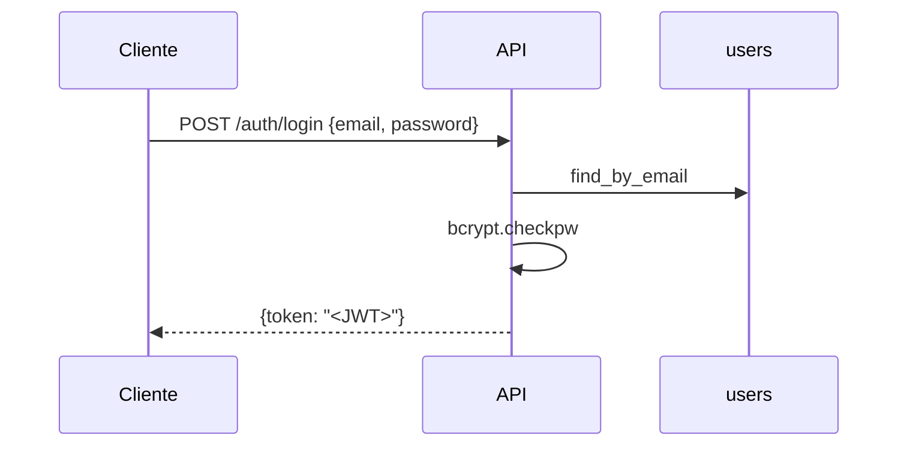

# Seguridad, autenticación y middlewares

## Contraseñas: bcrypt

`app/infrastructure/security/bcrypt_password_hasher.py` implementa el puerto `PasswordHasher`.

- `hash(password)`: genera una sal aleatoria con `bcrypt.gensalt()` y devuelve el hash. La sal queda dentro del propio hash.
- `verify(password, hash)`: compara con `bcrypt.checkpw`, que tarda lo mismo acierte o falle (tiempo constante).

La contraseña en texto plano solo existe durante la petición de registro o login; en la tabla `users` se guarda únicamente `password_hash`.

## Login y JWT

`LoginUserUseCase` busca el usuario por email, verifica la contraseña y genera un token con `JwtTokenGenerator` (`app/infrastructure/security/jwt_generator.py`, librería `PyJWT`):

| Claim | Valor |
| --- | --- |
| `sub` | ID del usuario |
| `iat` | Fecha de emisión (UTC) |
| `exp` | Emisión + 60 minutos |

Algoritmo: `HS256`. Si el email no existe o la contraseña es incorrecta, se lanza `InvalidCredentialsException` con el mismo mensaje en los dos casos (`Invalid email or password.`), para no revelar qué emails están registrados.



## Estado actual de la autorización

> **Importante:** la API **emite** tokens pero **no los valida**. No hay ningún endpoint protegido.

- No existe una dependencia del tipo `get_current_user` que lea el header `Authorization: Bearer <token>`.
- Los endpoints de carrito y checkout reciben el `user_id` en la ruta y confían en él: cualquiera que conozca un `user_id` puede leer o modificar ese carrito.
- `POST /articles` es público: cualquiera puede crear artículos.
- `GET /orders/{order_id}` y `POST /process-payment` no verifican que el pedido pertenezca a quien hace la petición.
- El secreto del JWT está fijo en el código (`"supersecretkey"`, en `get_token_generator()` de `main.py`) y no en `Settings`.

El frontend sí envía el token en `Authorization`, así que la API ya puede empezar a validarlo. Lo que faltaría:

1. Mover el secreto y la expiración a `Settings` (`JWT_SECRET_KEY`, `JWT_EXPIRATION_MINUTES`) y a `.env.example`.
2. Agregar un método `decode`/`verify` al puerto `TokenGenerator`.
3. Crear una dependencia que lea el header con `fastapi.security.HTTPBearer`, decodifique el token y devuelva el `user_id` (o `401`).
4. Usarla en los endpoints de carrito, checkout, pedidos y pagos, tomando el usuario del token en lugar de la ruta.

## Middlewares

El único middleware es **CORS** (`CORSMiddleware` de FastAPI):

```python
app.add_middleware(
    CORSMiddleware,
    allow_origins=settings.cors_origins,  # CORS_ORIGINS, ej. ["http://localhost:4321"]
    allow_credentials=True,
    allow_methods=["*"],
    allow_headers=["*"],
)
```

Permite que el frontend, servido desde otro origen (`localhost:4321`), haga peticiones a la API (`localhost:8000`) desde el navegador. Los orígenes se configuran con `CORS_ORIGINS` (ver [configuration.md](configuration.md)).

Las peticiones SSR del frontend (servidor a servidor) no pasan por CORS, porque el navegador no interviene.

No hay middlewares de autenticación, logging, rate limiting ni compresión. Los logs de acceso son los que imprime Uvicorn por defecto.

## Otros aspectos

- **Inyección SQL**: todas las consultas usan parámetros `?` (ver [database.md](database.md)).
- **Secretos**: `.env` está en `.gitignore` y `.dockerignore`. `Settings` usa `hide_input_in_errors=True`, para que un error de configuración no muestre valores como `STRIPE_SECRET_KEY`.
- **RustFS**: las credenciales `admin`/`password123` están fijas en el `docker-compose.yml` y el bucket es de lectura pública. Es aceptable para desarrollo, pero no para producción.
- **Montos de pago**: el monto se calcula en el servidor a partir del pedido; el cliente no puede enviarlo.
