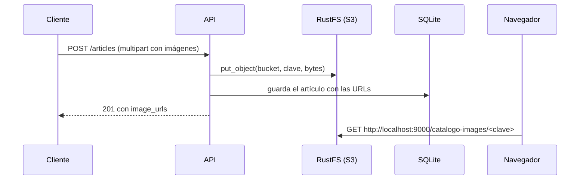

# Almacenamiento de imágenes (S3 / RustFS)

Las imágenes de los artículos se guardan en un almacenamiento de objetos compatible con la API de **Amazon S3**. La API se comunica con él usando `boto3`, el SDK oficial de AWS, apuntado a un endpoint propio en lugar de a Amazon. Por eso el código no depende de ningún proveedor concreto: sirve con RustFS, MinIO, SeaweedFS o el propio Amazon S3 cambiando solo las variables `S3_*`.

En el `docker-compose.yml` el servidor es **[RustFS](https://github.com/rustfs/rustfs)** (licencia Apache 2.0), que reemplaza a MinIO: las imágenes oficiales `minio/minio` y `minio/mc` dejaron de estar disponibles en Docker Hub (`pull access denied for minio/minio`).

En la base de datos solo se guarda la **URL pública** de cada imagen (columna `articles.image_urls`). El navegador descarga las imágenes directamente del almacenamiento, sin pasar por la API.



## Servicios en Docker

El `docker-compose.yml` de la raíz del monorepo define dos servicios:

| Servicio | Imagen | Función |
| --- | --- | --- |
| `storage` | `rustfs/rustfs:1.0.4` | Servidor. Puerto `9000` (API S3) y `9001` (consola web). Datos en el volumen `storage_data`. Tiene `healthcheck` sobre `/health`. |
| `storage-setup` | `amazon/aws-cli:2.31.0` | Tarea de un solo uso: espera a que `storage` esté sano, crea el bucket `catalogo-images`, le aplica una política de **lectura pública de objetos** y termina. |

La API (`api`) espera a que `storage-setup` termine bien antes de arrancar (`condition: service_completed_successfully`). Si la creación del bucket o la política fallan, `storage-setup` termina con error y la API no arranca, así el problema se ve enseguida.

- Consola web: http://localhost:9001/rustfs/console/, usuario `admin` y contraseña `password123` (definidos en el compose con `RUSTFS_ACCESS_KEY` y `RUSTFS_SECRET_KEY`).
- Crear el bucket otra vez no falla, así que `storage-setup` puede ejecutarse en cada `docker compose up`.

### Política del bucket

```json
{
  "Version": "2012-10-17",
  "Statement": [{
    "Effect": "Allow",
    "Principal": {"AWS": ["*"]},
    "Action": ["s3:GetObject"],
    "Resource": ["arn:aws:s3:::catalogo-images/*"]
  }]
}
```

Cualquiera puede **descargar** un objeto si conoce su URL, que es lo que necesita el navegador. En cambio, **no** se puede listar el contenido del bucket ni subir o borrar archivos sin credenciales (`GET /catalogo-images` sin firmar responde `403`).

## Adaptador `S3FileStorage`

`app/infrastructure/storage/s3_file_storage.py` implementa el puerto `FileStoragePort`:

```python
class FileStoragePort(ABC):
    def upload_image(self, file_name: str, file_bytes: bytes, content_type: str) -> str: ...
```

- Antepone 8 caracteres aleatorios al nombre del archivo (`a1b2c3d4_zapato.jpg`) para evitar colisiones.
- Sube el archivo con `put_object` conservando su `Content-Type`.
- Devuelve la URL `{public_url}/{bucket}/{clave}` (estilo *path*, el que entienden RustFS y MinIO).
- Si el almacenamiento responde con error (`ClientError`), lanza `RuntimeError("Error al subir la imagen al almacenamiento S3: ...")`, que termina en un `500`.

## Endpoint interno y URL pública

El adaptador recibe **dos URLs**, porque quien sube la imagen y quien la descarga no están en la misma red:

| Variable | Uso | Local | Docker |
| --- | --- | --- | --- |
| `S3_ENDPOINT` | La API se conecta para **subir** | `http://localhost:9000` | `http://storage:9000` (red interna) |
| `S3_PUBLIC_URL` | Base de la URL que se guarda y usa el **navegador** | `http://localhost:9000` | `http://localhost:9000` |

Dentro de Docker, `localhost` es el propio contenedor de la API; por eso necesita `storage:9000` para llegar al almacenamiento. El navegador, en cambio, no conoce el nombre `storage` y usa `localhost:9000`, el puerto publicado en el host. Si no se pasa `public_url` al adaptador, se usa `endpoint_url`.

> Como la URL completa queda guardada en la base de datos, cambiar `S3_PUBLIC_URL` no actualiza las imágenes que ya existen. Hay que volver a ejecutar el seed o actualizar las filas.

## Configuración

| Variable | Valor con el compose actual |
| --- | --- |
| `S3_ACCESS_KEY` | `admin` |
| `S3_SECRET_KEY` | `password123` |
| `S3_BUCKET` | `catalogo-images` |

Deben coincidir con `RUSTFS_ACCESS_KEY`, `RUSTFS_SECRET_KEY` y el bucket que crea `storage-setup` en el `docker-compose.yml`. Ver [configuration.md](configuration.md).

## Usos

- `POST /api/v1/articles`: sube las imágenes recibidas (máximo 5) y luego crea el artículo.
- `seed.py`: sube por cada artículo una imagen local de `static/` y una aleatoria de `https://picsum.photos` (ver [seed.md](seed.md)).

Si la creación del artículo falla después de subir las imágenes, estas quedan huérfanas en el bucket (ver [known-issues.md](known-issues.md)).

## Migrar desde MinIO

Los datos del volumen antiguo (`project-virtual-catalog_minio_data`) tienen el formato interno de MinIO y no se reutilizan: RustFS usa el volumen nuevo `storage_data`, que empieza vacío. Las URLs que ya están en la base de datos apuntan a archivos que ya no existen, así que hay que empezar de cero:

```bash
docker compose down
docker volume rm project-virtual-catalog_api_data project-virtual-catalog_minio_data
docker compose up -d --build
docker compose exec api python seed.py
```

En local, además, renombra en `virtual-catalog-api/.env` las variables `MINIO_*` a `S3_*` (ver [configuration.md](configuration.md)), borra `virtual-catalog-api/data/catalogo.db` y vuelve a ejecutar `python seed.py`.
