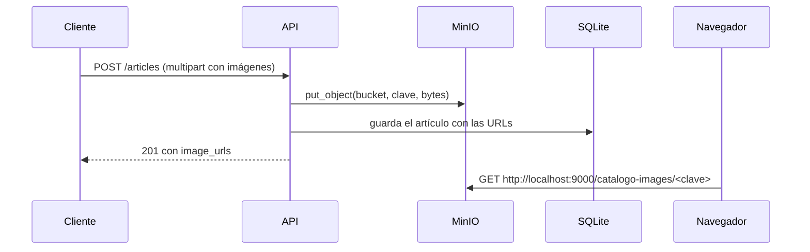

# Almacenamiento de imágenes (MinIO)

Las imágenes de los artículos se guardan en **MinIO**, un servidor de almacenamiento de objetos compatible con la API de **Amazon S3**. La API se comunica con él usando `boto3`, el SDK oficial de AWS, apuntado a MinIO en lugar de a Amazon.

En la base de datos solo se guarda la **URL pública** de cada imagen (columna `articles.image_urls`). El navegador descarga las imágenes directamente de MinIO, sin pasar por la API.



## Servicios en Docker

El `docker-compose.yml` de la raíz del monorepo define dos servicios:

| Servicio | Imagen | Función |
| --- | --- | --- |
| `minio` | `minio/minio` | Servidor. Puerto `9000` (API S3) y `9001` (consola web). Datos en el volumen `minio_data`. |
| `minio-setup` | `minio/mc` | Tarea de un solo uso: crea el bucket `catalogo-images`, le da **acceso de lectura público** y termina. |

La API (`api`) espera a que `minio-setup` termine bien antes de arrancar (`condition: service_completed_successfully`).

- Consola web: http://localhost:9001, usuario `admin` y contraseña `password123` (definidos en el compose).
- El bucket es público para que el navegador pueda mostrar las imágenes sin credenciales.

## Adaptador `MinioFileStorage`

`app/infrastructure/storage/minio_file_storage.py` implementa el puerto `FileStoragePort`:

```python
class FileStoragePort(ABC):
    def upload_image(self, file_name: str, file_bytes: bytes, content_type: str) -> str: ...
```

- Antepone 8 caracteres aleatorios al nombre del archivo (`a1b2c3d4_zapato.jpg`) para evitar colisiones.
- Sube el archivo con `put_object` conservando su `Content-Type`.
- Devuelve la URL `{public_url}/{bucket}/{clave}`.
- Si MinIO responde con error (`ClientError`), lanza `RuntimeError`, que termina en un `500`.

## Endpoint interno y URL pública

El adaptador recibe **dos URLs**, porque quien sube la imagen y quien la descarga no están en la misma red:

| Variable | Uso | Local | Docker |
| --- | --- | --- | --- |
| `MINIO_ENDPOINT` | La API se conecta para **subir** | `http://localhost:9000` | `http://minio:9000` (red interna) |
| `MINIO_PUBLIC_URL` | Base de la URL que se guarda y usa el **navegador** | `http://localhost:9000` | `http://localhost:9000` |

Dentro de Docker, `localhost` es el propio contenedor de la API; por eso necesita `minio:9000` para llegar a MinIO. El navegador, en cambio, no conoce el nombre `minio` y usa `localhost:9000`, el puerto publicado en el host. Si `MINIO_PUBLIC_URL` no se define en el adaptador, se usa `MINIO_ENDPOINT`.

> Como la URL completa queda guardada en la base de datos, cambiar `MINIO_PUBLIC_URL` no actualiza las imágenes que ya existen. Hay que volver a ejecutar el seed o actualizar las filas.

## Configuración

| Variable | Valor con el compose actual |
| --- | --- |
| `MINIO_ACCESS_KEY` | `admin` |
| `MINIO_SECRET_KEY` | `password123` |
| `MINIO_BUCKET` | `catalogo-images` |

Deben coincidir con `MINIO_ROOT_USER`, `MINIO_ROOT_PASSWORD` y el bucket que crea `minio-setup` en el `docker-compose.yml`. Ver [configuration.md](configuration.md).

## Usos

- `POST /api/v1/articles`: sube las imágenes recibidas (máximo 5) y luego crea el artículo.
- `seed.py`: sube por cada artículo una imagen local de `static/` y una aleatoria de `https://picsum.photos` (ver [seed.md](seed.md)).

Si la creación del artículo falla después de subir las imágenes, estas quedan huérfanas en el bucket (ver [known-issues.md](known-issues.md)).
